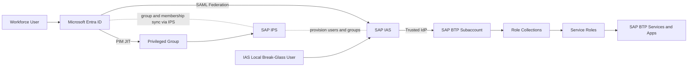

# SAP BTP Identity and Access Governance - End-to-End PoC Lab Guide

## 1. Purpose and Intended Outcome

This Proof of Concept (PoC) demonstrates how to implement enterprise-grade Identity and Access Management (IAM) for SAP BTP using:

- Microsoft Entra ID as the corporate identity and governance plane
- SAP Identity Authentication Service (IAS) as the SAP authentication broker
- SAP Identity Provisioning Service (IPS) for automated identity lifecycle synchronization
- SAP BTP role collections for platform authorization

This guide is designed for:

- Client demonstrations
- Architecture validation workshops
- Security and compliance design reviews
- Platform team enablement labs

By the end of the lab, you will have a working reference pattern for:

- SSO federation (Entra ID -> IAS -> SAP BTP)
- Group-driven provisioning and authorization
- Joiner/Mover/Leaver automation
- Just-in-time (JIT) privileged access using PIM
- Emergency break-glass access
- Auditability and control evidence generation

## 2. PoC Scope, Assumptions, and Non-Goals

### 2.1 In Scope

- SAP BTP subaccount access governance
- Entra ID group-based access model
- IAS federation and authentication control
- IPS synchronization (users, groups, memberships)
- RBAC mapping to BTP role collections
- JIT admin with Entra PIM
- Break-glass operating model
- Validation and demo scenarios

### 2.2 Assumptions

The repository focuses on SAP BTP governance. For this PoC, the following assumptions are used where details were not explicitly defined:

- One SAP BTP global account with at least DEV and PROD subaccounts
- One IAS tenant and one IPS tenant available
- Entra ID is the corporate IdP and source of workforce identities
- SAP business applications (for example S/4HANA, ECC, SuccessFactors) can be onboarded later to the same IAS trust model
- Role collection assignment in BTP is mapped from IAS groups that originate from Entra groups

### 2.3 Non-Goals (for this PoC)

- Full SoD policy engine implementation
- Full ITSM integration automation (ServiceNow/Jira) for approval workflows
- Full production hardening of all controls across all landscapes

## 3. Architecture Overview

### 3.1 Logical Architecture



### 3.2 Control Planes and Why They Matter

| Component | Role in Architecture | Why it is included in PoC |
|---|---|---|
| Microsoft Entra ID | Corporate identity source, governance, PIM, Conditional Access | Centralizes identity and governance policies |
| SAP IAS | Authentication broker for SAP targets | Decouples SAP app trust from direct corporate IdP dependencies |
| SAP IPS | Provisioning and lifecycle synchronization | Eliminates manual user and group administration |
| SAP BTP Subaccounts | Runtime platform boundary (DEV/PROD) | Enforces environment-level segregation and least privilege |
| BTP Role Collections | Authorization aggregation layer | Provides predictable and auditable role assignment model |

### 3.3 Protocol and Integration Standards Used

- SAML 2.0: Entra ID to IAS federation and IAS to BTP trust
- SCIM-like provisioning flows through IPS connectors: user and group synchronization
- OIDC (optional extension): for modern custom apps on BTP that require token-based app auth

## 4. Prerequisites

### 4.1 Licensing and Subscription Requirements

| Platform | Minimum Requirement | PoC Feature Impact |
|---|---|---|
| Microsoft Entra ID | P1 minimum, P2 recommended | P2 is needed for PIM JIT demo |
| SAP BTP | Global account + subaccount entitlements | Required for role collections and trust configuration |
| SAP IAS | Active tenant | Required for SSO broker pattern |
| SAP IPS | Active tenant | Required for lifecycle provisioning |
| Optional: Microsoft Sentinel / Log Analytics | Workspace available | Required if demonstrating centralized audit monitoring |

### 4.2 Access and Administrative Roles

- Entra Global Administrator (or delegated equivalent for app, groups, and PIM)
- SAP BTP Global Account Administrator
- IAS Administrator
- IPS Administrator
- One approver identity for PIM requests

### 4.3 Required Systems and Tools

- Web browser with private/incognito mode support
- Access to Entra admin portal and SAP BTP cockpit
- Optional: Microsoft Graph PowerShell for repeatable setup
- Optional: SAP BTP CLI for role automation extension

### 4.4 Lab Data Set (Recommended)

| Persona | User Principal Name | Purpose |
|---|---|---|
| Standard Developer | alex.developer@contoso.com | Baseline access and joiner/mover tests |
| Platform Admin (eligible) | priya.admin@contoso.com | PIM JIT activation scenario |
| PIM Approver | sam.approver@contoso.com | Approval workflow demonstration |
| Emergency Account | btp-emergency-admin | Federation outage recovery scenario |

## 5. Target Naming Model for the PoC

Use a deterministic naming model to simplify demos and evidence collection.

### 5.1 Entra Security Groups

- SG-BTP-DEV-USERS
- SG-BTP-DEV-ADMINS
- SG-BTP-PROD-USERS
- SG-BTP-PROD-ADMINS

### 5.2 SAP BTP Role Collections

- RC_DEV_USERS
- RC_DEV_ADMINS
- RC_PROD_USERS
- RC_PROD_ADMINS
- RC_EMERGENCY_ADMIN

### 5.3 Group-to-Role Mapping Matrix

| Entra Group | IAS Group (via IPS) | BTP Role Collection | Effective Access |
|---|---|---|---|
| SG-BTP-DEV-USERS | SG-BTP-DEV-USERS | RC_DEV_USERS | DEV viewer/developer as defined |
| SG-BTP-DEV-ADMINS | SG-BTP-DEV-ADMINS | RC_DEV_ADMINS | DEV admin privileges |
| SG-BTP-PROD-USERS | SG-BTP-PROD-USERS | RC_PROD_USERS | PROD business/runtime user access |
| SG-BTP-PROD-ADMINS | SG-BTP-PROD-ADMINS | RC_PROD_ADMINS | PROD admin via PIM eligible activation |
| EMERGENCY_ADMINS (IAS local) | EMERGENCY_ADMINS | RC_EMERGENCY_ADMIN | Break-glass administrative access |

## 6. Step-by-Step Implementation Guide

Estimated lab duration: 1 to 2 working days for setup and validation, plus 45 minutes for client demonstration.

### Phase 0 - Prepare the Lab

### Objective

Ensure all identities, groups, and environments are ready before federation and provisioning.

### Steps

1. Create the four Entra groups in Section 5.1.
2. Create test users and assign base group membership:
   - Add alex.developer to SG-BTP-DEV-USERS.
   - Keep priya.admin eligible candidate for SG-BTP-PROD-ADMINS (do not grant active membership yet).
3. Confirm DEV and PROD subaccounts exist in SAP BTP.

### Why this step matters

Clean pre-staging avoids cross-environment permission drift and simplifies scenario testing.

### Optional automation snippet (Graph PowerShell)

```powershell
Connect-MgGraph -Scopes "Group.ReadWrite.All","User.Read.All"

$groups = @(
  @{DisplayName="SG-BTP-DEV-USERS"; MailNickname="sg-btp-dev-users"},
  @{DisplayName="SG-BTP-DEV-ADMINS"; MailNickname="sg-btp-dev-admins"},
  @{DisplayName="SG-BTP-PROD-USERS"; MailNickname="sg-btp-prod-users"},
  @{DisplayName="SG-BTP-PROD-ADMINS"; MailNickname="sg-btp-prod-admins"}
)

foreach ($g in $groups) {
  New-MgGroup -DisplayName $g.DisplayName -Description "SAP BTP PoC" -MailEnabled:$false -SecurityEnabled:$true -MailNickname $g.MailNickname
}
```

### Phase 1 - Configure SAP Trust Foundation (IAS and BTP)

### Objective

Establish SAP-side trust so BTP can delegate authentication to IAS.

### Steps

1. In SAP BTP subaccount (DEV and PROD):
   - Go to Security -> Trust Configuration.
   - Establish trust with the IAS tenant.
2. In IAS:
   - Verify tenant is active for corporate IdP federation.
   - Prepare SAML metadata endpoint for Entra federation.

### Why this step matters

Without IAS trust, downstream BTP role collections cannot be evaluated for federated users.

### Phase 2 - Configure Entra ID Enterprise App and SSO (SAML)

### Objective

Enable users to authenticate with Entra credentials and seamlessly reach BTP through IAS.

### Steps

1. In IAS:
   - Create a Corporate Identity Provider for Microsoft Entra ID.
   - Download IAS SAML metadata.
2. In Entra admin center:
   - Create a non-gallery enterprise application named SAP BTP PoC.
   - Configure SAML-based SSO and import IAS metadata.
   - Ensure claim mapping includes:
     - user.userprincipalname -> loginName
     - givenname -> firstName
     - surname -> lastName
     - mail -> email
   - Download Entra Federation Metadata XML.
3. Back in IAS:
   - Upload Entra metadata.
   - Set identity provider type to Microsoft AAD.
   - Enable identity-provider-specific user behavior and user creation at logon.
4. Assign test users or groups to the Entra enterprise app.

### Why this step matters

This ensures a single identity source and consistent principal mapping from Entra to SAP identity records.

### Validation checkpoint

- A test user can start at BTP URL and is redirected to Entra login.
- Successful login results in IAS-authenticated session.

### Phase 3 - Configure IPS Provisioning (Entra to IAS)

### Objective

Automate user, group, and membership synchronization for lifecycle governance.

### Steps

1. In IPS, create source system: Microsoft Azure Active Directory.
2. Configure source properties (tenant details and credentials/certificates as required).
3. Add filters to scope only SAP groups:

```text
aad.group.filter=startswith(displayName, "SG-BTP-")
```

4. In IPS, create target system: Identity Authentication (IAS).
5. Enable object sync for users, groups, and group memberships.
6. Run a test job, then schedule recurring job.
7. Validate in IAS that groups and memberships appear correctly.

### Why this step matters

Provisioning is the control point for Joiner/Mover/Leaver automation and audit consistency.

### Expected output

- IAS contains synchronized groups matching Entra naming model.
- User membership changes in Entra propagate to IAS.

### Phase 4 - Configure SAP BTP Authorization (Role Collections)

### Objective

Translate synchronized identity groups into effective platform permissions.

### Steps

1. In each BTP subaccount, create role collections from Section 5.2.
2. Add least-privilege service roles to each collection.
   - Example user role: subaccount viewer/developer capabilities only.
   - Example admin role: subaccount admin and required platform admin scopes.
3. Map each role collection to corresponding IAS group from Section 5.3.
4. Validate that no direct user assignment bypasses the group model.

### Why this step matters

Authorization must be group-driven to remain scalable, reviewable, and automatable.

### Phase 5 - Configure JIT Privileged Access (Entra PIM)

### Objective

Replace permanent PROD admin access with time-bound approved access.

### Steps

1. In Entra PIM, onboard SG-BTP-PROD-ADMINS for privileged access management.
2. Configure activation settings:
   - Approval required
   - MFA required
   - Justification and ticket ID required
   - Maximum activation duration: 2 hours
3. Assign priya.admin as eligible, not active.
4. Execute one activation and verify group membership appears during active window.

### Why this step matters

JIT enforces least privilege and provides high-quality audit evidence for privileged operations.

### Expected output

- Admin rights appear only after approved activation.
- Access automatically expires without manual cleanup.

### Phase 6 - Configure Emergency Break-Glass Access

### Objective

Maintain recoverability during federation outages or lockouts.

### Steps

1. In IAS, create local user btp-emergency-admin.
2. Create IAS group EMERGENCY_ADMINS and add local user.
3. In BTP, map EMERGENCY_ADMINS to RC_EMERGENCY_ADMIN.
4. Store credentials in a secure vault and define rotation schedule (90 days recommended).
5. Document strict usage policy:
   - Allowed only under incident declaration
   - Mandatory post-use review and credential reset

### Why this step matters

Break-glass balances resilience with controlled, auditable emergency access.

### Phase 7 - Optional Extensions for SAP ECC and S/4HANA

Use this section when client scope includes broader SAP landscape integration.

### Option A: SSO Standardization via IAS

- Federate IAS as central broker for SAP applications where supported.
- Keep Entra as corporate IdP and apply consistent identity attributes.

Example targets:

- SAP S/4HANA Cloud applications integrated with IAS-based SSO.
- SAP SuccessFactors and SAP Fiori launch experiences aligned to the same corporate login pattern.

### Option B: Lifecycle Governance Alignment

- Reuse SG-BTP-* style governance model concept for SAP business roles.
- Align app-specific role groups with enterprise joiner/mover/leaver workflows.

Example approach:

- Use separate group prefixes for business app roles (for example SG-S4-*) while retaining the same governance lifecycle and access review process.

### Option C: Modern App Front Ends on BTP (OIDC)

- For custom BTP apps, use OIDC/OAuth with Entra app registrations.
- Keep user authorization still group-based and synchronized to app roles.

### Option D: SAP ECC or S/4HANA On-Premise via AS ABAP

- Configure SAML trust in SAP NetWeaver AS ABAP (transaction SAML2) with IAS as trusted identity provider.
- Standardize NameID and principal mapping to align with Entra UPN where possible.
- Validate fallback authentication procedure and emergency admin processes for critical outage scenarios.

## 7. User Lifecycle Scenarios (Joiner, Mover, Leaver)

### 7.1 Joiner Scenario

1. Add new employee to SG-BTP-DEV-USERS.
2. IPS sync runs.
3. IAS user and membership appear.
4. User signs in and receives DEV user access only.

Expected outcome:

- No manual BTP user creation.
- Access granted through governed group mapping.

### 7.2 Mover Scenario

1. User moves from DEV to PROD operations.
2. Remove from SG-BTP-DEV-USERS.
3. Add as eligible to SG-BTP-PROD-ADMINS.
4. User requests PIM activation only when needed.

Expected outcome:

- DEV access removed.
- PROD admin only during approved activation window.

### 7.3 Leaver Scenario

1. Disable or remove user in Entra ID.
2. IPS sync updates IAS.
3. Access to BTP and mapped roles is revoked.

Expected outcome:

- Deprovisioning is consistent and auditable.
- No orphaned privileged access remains.

## 8. Testing and Validation Plan

### 8.1 Functional Validation Checklist

| Test ID | Test Case | Expected Result |
|---|---|---|
| T1 | User in SG-BTP-DEV-USERS logs in | Successful SSO, DEV user permissions only |
| T2 | User not assigned to app attempts login | Access denied or no role collection assignment |
| T3 | PIM eligible admin without activation logs in | No PROD admin rights |
| T4 | PIM activation approved and user logs in | PROD admin rights available within time window |
| T5 | PIM activation expires | PROD admin rights automatically removed |
| T6 | Break-glass login path used | Emergency admin access succeeds and is logged |
| T7 | User removed from Entra group | IAS membership and BTP access removed after sync |

### 8.2 Control Validation Checklist

- Claim mapping validated (loginName matches UPN)
- IPS filter validated (only SG-BTP-* groups synchronized)
- Role collections mapped only to groups (no direct user exceptions)
- PIM policy enforced for privileged groups
- Break-glass runbook tested and signed off
- Audit logs available for sign-in and privileged changes

### 8.3 Evidence to Capture for Client and Audit Teams

- Screenshot: Entra enterprise app SAML configuration
- Screenshot: IAS corporate IdP configuration
- Screenshot: IPS job result with users/groups/memberships
- Screenshot: BTP role collection to group mapping
- Screenshot: PIM eligible assignment and activation policy
- Screenshot: Access review schedule (if configured)
- Export: Audit event samples for privileged actions

## 9. Client Demonstration Script (45 Minutes)

### 9.1 Demo Storyline

1. Explain architecture and controls (5 min).
2. Show SSO and baseline DEV access (10 min).
3. Show Joiner and Mover flow via group change (10 min).
4. Show JIT admin activation through PIM (10 min).
5. Show break-glass procedure and governance controls (5 min).
6. Summarize business value and next steps (5 min).

### 9.2 Suggested Talking Track by Outcome

| Capability | Business Message |
|---|---|
| SSO and federation | Better user experience and fewer password-related support issues |
| Group-based provisioning | Reduced manual effort and fewer entitlement errors |
| JIT privileged access | Lower standing privilege risk and stronger compliance posture |
| Break-glass path | Resilience during outages without losing governance |
| Audit evidence | Faster audit cycles and improved control transparency |

## 10. Business Value and KPI Framework

Use these KPIs during PoC closeout:

| KPI | Baseline | PoC Target |
|---|---|---|
| Time to grant standard BTP access | Manual and variable | Less than 30 minutes via group sync |
| Permanent PROD admin assignments | Common | 0 permanent assignments for tested admins |
| Access revocation delay for leavers | Potentially days | Same day after sync cycle |
| Audit evidence collection effort | High manual effort | Repeatable evidence package per release cycle |

## 11. Troubleshooting Quick Reference

| Symptom | Likely Cause | Corrective Action |
|---|---|---|
| User authenticates but has no access | Missing group-to-role mapping | Verify IAS group mapping to role collection |
| User does not appear in IAS | IPS filter or connector issue | Check aad.group.filter and IPS job logs |
| PIM activation succeeds but role not effective | Token/session still old | Sign out/in and retry after membership propagation |
| Break-glass login fails | Local user policy or lockout | Verify IAS local user status and rotation process |

## 12. Production Hardening Next Steps

After successful PoC, prioritize:

1. RBAC as code with CI/CD and change approvals.
2. Conditional Access policies for SAP enterprise applications.
3. Periodic Entra access reviews by environment criticality.
4. SIEM integration for privileged event analytics and alerting.
5. Formal control mapping to ISO 27001, SOX, and Zero Trust policy standards.

## 13. Final PoC Success Criteria

The PoC is complete when all criteria below are met:

- SSO works end-to-end using Entra ID and IAS.
- IPS synchronizes users, groups, and memberships with scoped filtering.
- BTP permissions are granted only through mapped role collections.
- JIT privileged access works with approval and expiration.
- Break-glass access is tested, documented, and controlled.
- Joiner, Mover, and Leaver scenarios pass with expected outcomes.
- Evidence package is available for both client stakeholders and auditors.
