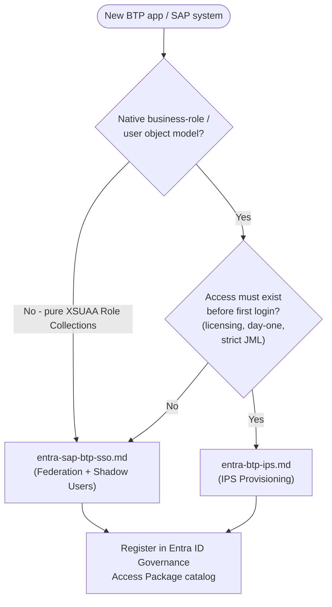

# Designing the Architecture — Entra ID ↔ SAP BTP IAM

This folder holds the working design notes for how Microsoft Entra ID integrates with SAP BTP for authentication and authorization. These are **design-phase documents** — brainstorming and pattern research written up before the formal implementation guide/runbook (see the repo root) gets locked in.

Three patterns are documented, because no single one covers a real SAP landscape end to end — which pattern applies depends on what a given target system requires.

## Contents

| File | Pattern | Use it when... |
|---|---|---|
| [`entra-sap-btp-sso.md`](./entra-sap-btp-sso.md) | **Federation + Shadow Users** — Entra → IAS (proxy) → BTP, no pre-provisioning. Access is granted purely via Entra group membership mapped to BTP Role Collections. | The target is a Cloud Foundry / XSUAA-based BTP app where authorization is entirely expressed as Role Collections. |
| [`entra-btp-ips.md`](./entra-btp-ips.md) | **IPS Provisioning** — Entra → SAP Cloud Identity Services (Identity Provisioning) → target system, users/groups actively provisioned ahead of login. | The target has a native business-role/user object model (BTP ABAP Environment, SuccessFactors, S/4HANA Cloud, Ariba, etc.) or needs day-one access / strict JML deprovisioning / license counting. |
| [`hybrid-setup.md`](./hybrid-setup.md) | **Hybrid** — both of the above, run side by side and routed per target system, unified under a single Microsoft Entra ID Governance (Access Packages) request/approval experience. | Real, mixed SAP landscapes — most of what SAP BTP CoE will actually build. **Start here** for the overall architecture; it links into the other two for implementation detail. |

## Recommended Reading Order

1. **`hybrid-setup.md`** — get the overall shape and the decision framework for routing a given target system to the right track first.
2. **`entra-sap-btp-sso.md`** — implementation detail for Track A.
3. **`entra-btp-ips.md`** — implementation detail for Track B.

All three cross-link to each other; you can also jump straight to whichever track is relevant to the system you're currently onboarding.

## Quick Decision Guide

Full rationale for this decision flow, including the shared Entra ID Governance layer that sits on top of both tracks, is in `hybrid-setup.md`.

## Status

These are **design notes**, not yet finalized architecture. They're the input to:

- `../SAP BTP Identity & Access Governance Architecture Runbook.md`
- `../SAP BTP Identity & Access Governance Implementation Guide.md`
- `../PoC-guide.md`

As decisions get validated in a PoC or pilot, promote the relevant details into those documents and keep this folder as the historical design rationale / "why we chose this" reference.

## Contributing

If you add a new target system or pattern variant:

1. Run it through the decision guide above and record the outcome.
2. If it fits an existing track, add it as a use case in that doc rather than creating a new file.
3. If it genuinely needs a new pattern, add a new `.md` file here following the same structure (Overview → Architecture → Key Concepts → Design Decisions → Tutorial → Use Cases → When It Doesn't Fit → Operational Considerations → References) and link it from this README.