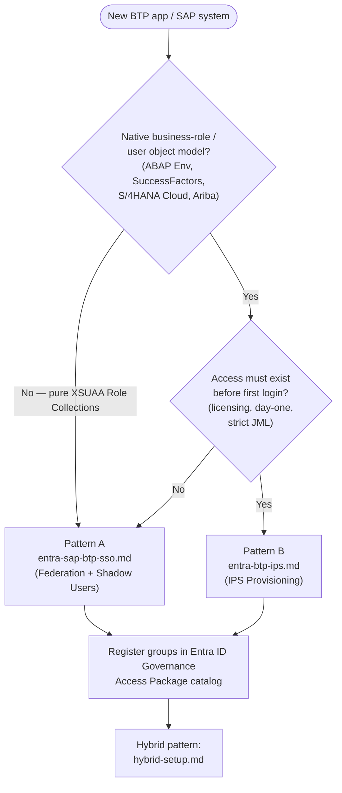

# Microsoft Entra ID ↔ SAP BTP: Identity Architecture Reference

This folder documents three proven integration patterns for connecting **Microsoft Entra ID** to **SAP Business Technology Platform (BTP)** for authentication and authorization. Together they form a complete architecture reference — from a lightweight SSO-only setup through to full lifecycle provisioning and unified governance — covering the full spectrum of what enterprise SAP landscapes actually require.

> **Why this matters now:** SAP Identity Management (IDM) mainstream maintenance ends **December 31, 2027** (extended maintenance available through 2030 at additional cost, with no further functional releases). Microsoft and SAP jointly recommend Microsoft Entra ID as the target platform. Organizations beginning that migration today need a clear architecture to land on — these patterns are that architecture.

---

## Patterns at a Glance

| Pattern | File | Core Mechanism | When to Use |
|---|---|---|---|
| **A — Federation + Shadow Users** | [`entra-sap-btp-sso.md`](./entra-sap-btp-sso.md) | Entra ID → IAS (SAML proxy) → BTP; users created automatically at first login; access driven by Entra group membership mapped to BTP Role Collections | Cloud Foundry / XSUAA-based BTP apps where authorization is entirely expressed as Role Collections |
| **B — IPS Provisioning** | [`entra-btp-ips.md`](./entra-btp-ips.md) | Entra ID → SAP Cloud Identity Services (SCIM) → IPS → target system; users and groups provisioned ahead of any login event | Systems with a native business-role/user object model (BTP ABAP Environment, SuccessFactors, S/4HANA Cloud, Ariba); or where day-one access, license counting, or strict JML deprovisioning is required |
| **Hybrid** | [`hybrid-setup.md`](./hybrid-setup.md) | Both patterns run side by side, routed per target system; unified under a single Microsoft Entra ID Governance (Access Packages) request/approval experience | Real, mixed SAP landscapes — the pattern most enterprises converge on |

**Recommended reading order:** start with [`hybrid-setup.md`](./hybrid-setup.md) for the overall decision framework and routing logic, then read the pattern-specific docs for implementation detail.

---

## Quick Decision Guide

---

## Architecture Principles

These patterns are built on a small set of durable principles:

1. **Entra ID is the authoritative identity source.** No passwords are created or managed in SAP. All authentication flows back to Entra, including MFA and Conditional Access policy enforcement.

2. **SAP Cloud Identity Services – IAS is always the SAML proxy.** Entra never federates directly to BTP subaccounts or individual SAP applications. Trust is configured once in IAS and reused across all subaccounts and environments — one place for certificate management, one place for federation health monitoring.

3. **Provisioning and authentication are independent pipelines.** IPS (provisioning) and SAML SSO (authentication) share the same IAS tenant as their meeting point but operate independently. An outage in one does not break the other.

4. **Authorization lives in Entra groups, not in SAP.** Whether a user gets a BTP Role Collection (Pattern A) or an ABAP business role (Pattern B) is determined by their Entra group membership. Granting or revoking access is a single group membership change in Entra — no SAP-side administration required for day-to-day access management.

5. **The request/approval experience is unified in Entra ID Governance.** End users and approvers should not need to know whether an access request results in a SAML group claim resolved at login, or a SCIM provisioning job — they interact with one Access Package catalog.

---

## Document Structure

Each pattern document follows the same structure so you can navigate predictably across all three:

1. **Overview** — what the pattern does and when to use it
2. **Architecture** — component diagrams, sequence flows, and authorization model
3. **Key Concepts** — glossary of the moving parts
4. **Design Decisions & Rationale** — the *why* behind each architectural choice
5. **Tutorial: Step-by-Step Setup** — actionable implementation guide
6. **Use Cases** — concrete scenarios where the pattern fits
7. **When This Pattern Does Not Fit** — explicit anti-patterns and boundaries
8. **Operational Considerations & Gotchas** — production-readiness notes
9. **References & Resources** — official Microsoft and SAP documentation

---

## Scope and Boundaries

These documents cover:
- Microsoft Entra ID (cloud-only) as the leading identity provider
- SAP Cloud Identity Services (IAS + IPS) as the integration layer
- SAP BTP — Cloud Foundry/XSUAA, BTP ABAP Environment
- SAP SuccessFactors, S/4HANA Cloud, and Ariba as provisioning targets
- Microsoft Entra ID Governance — Entitlement Management, Lifecycle Workflows

Out of scope (addressed separately):
- SAP on-premises systems (SAP ECC, on-prem S/4HANA via direct LDAP/SNC)
- SAP GRC Access Control on-premises (the Entra ↔ SAP AC connector is in private preview as of mid-2026; track for future inclusion)
- Non-Microsoft identity providers as the leading IdP
