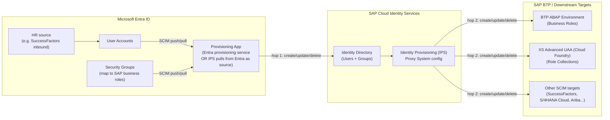
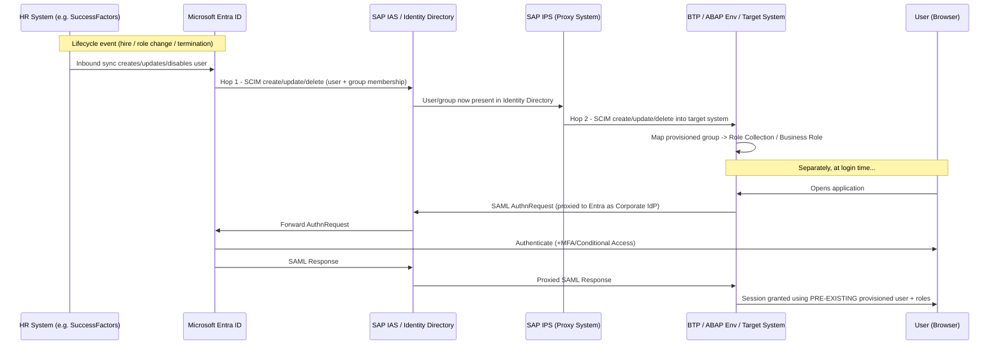
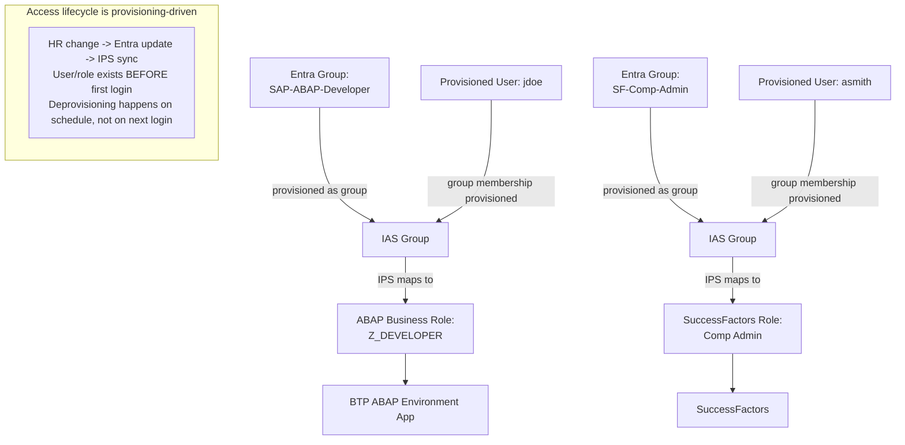

# Microsoft Entra ID → SAP BTP: Identity Provisioning (IPS) with Role Collection Assignment

> **Scenario scope:** This note covers the **provisioning-based** pattern — users (and optionally groups) are actively created, updated, and removed in SAP BTP / SAP Cloud Identity Services ahead of and independent of any login event, using SAP Cloud Identity Services – Identity Provisioning (IPS). This complements, and does **not** replace, SSO — provisioning handles the user/authorization *lifecycle*, while SAML federation still handles *authentication*. Contrast this with the [shadow-user/federation-only pattern](./entra-btp-sso-shadow-users.md), which never creates a user until first login.

---

## Table of Contents

- [1. Overview](#1-overview)
- [2. Architecture](#2-architecture)
- [3. Key Concepts](#3-key-concepts)
- [4. Design Decisions & Rationale](#4-design-decisions--rationale)
- [5. Tutorial: Step-by-Step Setup](#5-tutorial-step-by-step-setup)
- [6. Use Cases](#6-use-cases)
- [7. When This Pattern Does *Not* Fit](#7-when-this-pattern-does-not-fit)
- [8. Operational Considerations & Gotchas](#8-operational-considerations--gotchas)
- [9. References & Resources](#9-references--resources)

---

## 1. Overview

Some SAP systems and use cases can't rely on a shadow user being lazily created the first time someone logs in — the user record (and often their business attributes) needs to **exist beforehand**. Typical drivers: systems with native business-role/user objects (SAP BTP ABAP Environment, SuccessFactors, S/4HANA Cloud, Ariba), license/seat counting, day-one access requirements, and joiner-mover-leaver (JML) automation that must deprovision access the moment HR marks someone as terminated — not "whenever they next try to log in."

This pattern solves that with a **two-hop provisioning pipeline**:

1. **Entra ID → SAP Cloud Identity Services (IAS/Identity Directory):** users (and optionally groups) are pushed from Entra into the SAP Cloud Identity Directory.
2. **SAP Cloud Identity Services → downstream SAP application (BTP):** SAP's own **Identity Provisioning (IPS)** service takes users/groups already present in the Identity Directory and provisions them onward into BTP (ABAP Environment, Cloud Foundry/XSUAA, or other SCIM-enabled targets).

Authentication is still handled separately via SAML SSO (Entra → IAS → BTP, same as the federation pattern) — provisioning and authentication are two independent pipelines that happen to share the same identity store (IAS) as their meeting point.

---

## 2. Architecture

### 2.1 Two-Hop Provisioning Pipeline

**Two supported options for Hop 1** (per Microsoft/SAP guidance):

| Option | How it works | Best when |
|---|---|---|
| **A — Entra native provisioning service** | Create an Enterprise Application representing SAP Cloud Identity Services in Entra; assign users directly to it; Entra's provisioning engine pushes SCIM create/update/delete calls to IAS. | You don't need Entra *groups* to drive SAP business-role assignment — a flat "has access / doesn't" model is enough at this hop. |
| **B — IPS pulls from Entra AD as a source system** | Configure Microsoft Entra ID as a **source system** inside IPS itself; IPS reads users and groups from Entra on a schedule and writes them into the Identity Directory, preserving group membership. | You want to carry Entra **group** membership through to SAP business-role mapping (most common when Role Collections or ABAP business roles are group-driven). |

### 2.2 End-to-End Sequence (Provisioning + Authentication)

Notice the key difference from the shadow-user pattern: by the time the user logs in, their account and role assignment **already exist** — login only establishes a session, it does not create anything.

### 2.3 Authorization Model

---

## 3. Key Concepts

| Concept | Description |
|---|---|
| **IPS (Identity Provisioning Service)** | The SAP Cloud Identity Services component responsible for actively creating/updating/deleting users and groups in downstream target systems via SCIM, on a scheduled job basis (not tied to login). |
| **Source system** | Where IPS reads identity data from. Microsoft Entra ID (Azure AD) can be configured directly as an IPS source, or IAS's Identity Directory can act as the source for the second hop. |
| **Proxy system** | An IPS concept for target systems that require a bridge/agent rather than being reached directly (used for on-prem or specially-gated systems, e.g. BTP ABAP Environment via a Communication User/System). |
| **Target system** | Where IPS writes identity data to — e.g., "SAP BTP ABAP environment" or "SAP BTP XS Advanced UAA (Cloud Foundry)" are both explicit target system types in IPS. |
| **SCIM (System for Cross-domain Identity Management)** | The REST protocol IPS and Entra's provisioning service both use to create/read/update/delete users and groups. |
| **Read/Write transformations** | IPS mapping rules that translate source attributes/schema into the target system's expected schema (e.g., mapping Entra group membership into an SAP business role attribute). |
| **Two Hop-1 options** | (A) Entra's own provisioning service pushes to IAS as a target, or (B) IPS pulls from Entra AD as a source. Option B is generally preferred when group membership needs to flow through to SAP business-role assignment. |
| **Deprovisioning** | Because users are actively provisioned, removing a user from Entra (or from the source group) triggers a real delete/deactivate call downstream — access removal is driven by the provisioning job schedule, not by the user's next login attempt. |

---

## 4. Design Decisions & Rationale

| Decision | Why |
|---|---|
| Provision users **before** they ever log in | Systems like BTP ABAP Environment, SuccessFactors, and S/4HANA Cloud require a persisted user object with business attributes (cost center, company code, business role) to exist independently of authentication — a shadow user created only at login time isn't sufficient. |
| Use **IAS/Identity Directory as the intermediate hop**, not direct Entra → target | Centralizes schema mapping and target-system connectors in one place (IPS) instead of building bespoke SCIM integrations per SAP application; also lets the same identity data feed both provisioning and SSO. |
| Prefer **IPS pulling Entra AD as a source** (Option B) over Entra's native provisioning push (Option A) when group-driven role assignment is required | Preserves Entra group membership as first-class data in the Identity Directory, which IPS can then map into SAP business roles/Role Collections on the second hop. |
| Keep **SSO configured independently** of provisioning | Provisioning determines *who exists and what they're entitled to*; SAML federation determines *how they prove who they are*. Keeping them decoupled means an SSO outage doesn't stop provisioning (and vice versa), and each can be diagnosed independently. |
| **Start with a small pilot group** before full rollout | SAP/Microsoft guidance explicitly recommends testing with a small set of users/groups first, verifying downstream role assignment before broad rollout — provisioning misconfigurations affect real accounts, not just login sessions. |
| Drive user population from **HR system inbound** (e.g., SuccessFactors → Entra) where available | Ties the entire chain back to a single source of authority for joiner-mover-leaver events, so terminations and role changes propagate automatically instead of relying on manual group maintenance. |

---

## 5. Tutorial: Step-by-Step Setup

### Step 1 — Plan Your Provisioning Deployment

Decide:
- Which target(s) need pre-provisioned users (BTP ABAP Environment? Cloud Foundry/XSUAA? SuccessFactors? S/4HANA Cloud?).
- Whether you need Entra **groups** to drive role/business-role assignment (almost always yes for anything beyond a single flat role) — this determines whether you use Hop-1 Option A or B (see [2.1](#21-two-hop-provisioning-pipeline)).

### Step 2 — Ensure the Right Users (and Groups) Exist in Entra ID

- If HR is the source of authority, confirm HR-inbound sync (e.g., from SuccessFactors) is already populating and maintaining Entra users as employees join/move/leave.
- Create Entra security groups representing the SAP business roles you intend to provision, e.g. `SAP-ABAP-Developer`, `SF-Comp-Admin`.
- If licensed for Microsoft Entra ID Governance, consider automating application role assignments/group membership changes (access reviews, Lifecycle Workflows) so JML events flow through without manual group edits.

### Step 3 — Configure Provisioning: Entra ID → SAP Cloud Identity Services (Hop 1)

**Option A (Entra native provisioning service):**
1. Add/configure the Enterprise Application representing SAP Cloud Identity Services in Entra.
2. Assign the relevant users/groups to that application.
3. Configure Entra's automatic provisioning (SCIM) against IAS's SCIM endpoint.

**Option B (IPS pulls from Entra AD as source) — preferred for group-driven scenarios:**
1. In the IPS admin console, configure **Microsoft Azure Active Directory** as a source system.
2. Map the Entra groups you created in Step 2 to the SAP business roles/attributes expected downstream.
3. Confirm the read job successfully lands users and group memberships in the Identity Directory.

> Start small: pilot with a handful of test users/groups before enabling the job for the full population.

### Step 4 — Configure Provisioning: SAP Cloud Identity Services → BTP (Hop 2)

1. In IPS, add the downstream system as a **target**:
   - **SAP BTP ABAP environment** — typically requires a Communication User/System set up in the ABAP environment's Fiori Launchpad (Maintain Communication Users / Communication Systems apps), with the IPS target's certificate uploaded and the system marked Inbound Only.
   - **SAP BTP XS Advanced UAA (Cloud Foundry)** — configure directly as a SCIM target using the subaccount's UAA SCIM endpoint and credentials.
2. Configure the write transformation so provisioned groups map to the correct business role name (for ABAP, this is often an exact-name match with the business role) or Role Collection.
3. Run and validate the job — check the IPS job logs for create/update/skip/error status per user.

### Step 5 — Configure Single Sign-On (Independent of Provisioning)

Provisioning does not replace authentication. Set up SAML SSO for the same users, following the standard Entra ↔ IAS ↔ BTP federation configuration (see the companion [shadow-user/federation note](./entra-btp-sso-shadow-users.md) for the detailed steps — the SSO configuration itself is identical; the only difference is that here, the user record already exists before the first login instead of being created by it).

### Step 6 — Manage Ongoing Access via Group → Role Collection / Business Role Mapping

- For Cloud Foundry/XSUAA targets, map the provisioned IAS groups to BTP Role Collections (same mechanism as the federation pattern, just now backed by actually-provisioned group objects instead of SAML claims resolved at login).
- For ABAP Environment, ensure the provisioned group name matches the target business role name expected by the target system connector.
- Ongoing access changes = change Entra group membership → next IPS sync cycle propagates the change automatically (subject to job schedule/interval).

### Step 7 — Test End-to-End, Including Deprovisioning

1. Add a pilot user to the relevant Entra group; confirm the user and role assignment appear in the target system **before** any login attempt.
2. Log in via SSO and confirm the correct permissions are active immediately (no "first login creates the account" delay).
3. Remove the user from Entra (or disable via HR termination event) and confirm the next IPS job run deactivates/removes the account in the downstream target — note the propagation delay is bound by the **job schedule**, not instantaneous.

---

## 6. Use Cases

- **SAP BTP ABAP Environment** access, where business roles are tied to a persisted user object with real business attributes that must exist ahead of login.
- **SAP SuccessFactors, S/4HANA Cloud, SAP Ariba** and other SAP applications with native user/business-role models exposed via SCIM2, where IPS is the standard bridging mechanism.
- **License/seat management** — when you need an authoritative count of provisioned (not just "ever logged in") users for cost or compliance reporting.
- **Strict joiner-mover-leaver (JML) compliance** — access must be granted on day one and revoked immediately on termination, independent of whether/when the user next attempts to log in.
- **Mixed landscapes** — organizations running both this pattern (for systems needing real user objects) and the federation/shadow-user pattern (for pure Cloud Foundry apps) side by side, segmented by target system capability.

---

## 7. When This Pattern Does *Not* Fit

- **Simple Cloud Foundry / XSUAA-only BTP applications** where Role Collections are the entire authorization model — the [federation + shadow-user pattern](./entra-btp-sso-shadow-users.md) achieves the same outcome with far less integration surface (no SCIM jobs, schema mappings, or job monitoring to maintain).
- **Low-friction, fast-changing project access** (contractors, short-term app access) where the overhead of a provisioning job cycle (vs. instant group-claim resolution at login) isn't worth it.
- Situations where you specifically want **zero standing accounts** in SAP for users who never actually use the system — provisioning creates real accounts regardless of whether the person ever logs in, which shadow users avoid entirely.

---

## 8. Operational Considerations & Gotchas

- **Job scheduling and propagation delay:** IPS provisioning jobs run on a schedule, not in real time. Deprovisioning/role changes are only as fast as the job interval — factor this into your security/compliance SLAs, especially for terminations.
- **Schema/attribute mapping effort:** each target system (ABAP Environment, XSUAA, SuccessFactors, etc.) has its own expected schema and read/write transformations — this is real integration work per target, unlike the federation pattern's single group-claim mechanism.
- **Proxy system permissions:** provisioning into systems like BTP ABAP Environment requires proxy system access in the IPS admin console (the "Proxy Systems" tile) — if it's not visible, you need to raise an incident under component `BC-IAM-IPS` to get it enabled.
- **Communication User/System setup (ABAP Environment):** requires uploading the IPS target's certificate to a dedicated Communication User and marking the Communication System "Inbound Only" — an easy step to miss during initial setup.
- **Monitoring job failures:** IPS job runs can partially fail (some users created, some skipped/errored) — build monitoring/alerting on job status rather than assuming silent success.
- **Two sources of authorization truth if mixed carelessly:** if this pattern is combined with the federation/shadow-user pattern in the *same* subaccount, be explicit about which mechanism is authoritative for which app to avoid conflicting or duplicate role assignments.
- **Pilot before full rollout:** both Microsoft and SAP guidance explicitly recommend testing with a small set of users/groups first — a bad transformation mapping can create or misconfigure real accounts, not just fail a login attempt.
- **SSO must still be configured separately:** provisioning does not grant sign-in capability — SAML federation (Entra → IAS → BTP) is still required for actual authentication.

---

## 9. References & Resources

**Microsoft / Entra documentation**
- [Automate user provisioning and deprovisioning into SAP BTP with Microsoft Entra ID](https://learn.microsoft.com/en-us/entra/identity/saas-apps/sap-btp-provisioning-tutorial) — primary source for the two-hop provisioning pipeline and the two Hop-1 options
- [Plan deploying Microsoft Entra for user provisioning with SAP source and target applications](https://learn.microsoft.com/en-us/entra/identity/app-provisioning/plan-sap-user-source-and-target)
- [Configure SAP Cloud Identity Services for automatic user provisioning with Microsoft Entra ID](https://learn.microsoft.com/en-us/entra/identity/saas-apps/sap-cloud-platform-identity-authentication-provisioning-tutorial)
- [Automate user provisioning and deprovisioning to SaaS applications with Microsoft Entra ID (general concepts)](https://learn.microsoft.com/en-us/entra/identity/app-provisioning/user-provisioning)
- [Manage access to your SAP applications (Entra ID Governance)](https://learn.microsoft.com/en-us/entra/id-governance/sap)
- [Migrate identity management scenarios from SAP IDM to Microsoft Entra](https://learn.microsoft.com/en-us/entra/identity/app-provisioning/migrate-from-sap-idm)

**SAP documentation**
- [SAP Cloud Identity Services – Identity Provisioning overview](https://pages.community.sap.com/topics/cloud-identity-services/identity-provisioning)
- [Provisioning to SAP BTP ABAP environment (target system)](https://help.sap.com/docs/cloud-identity-services/cloud-identity-services/target-sap-btp-abap-environment)
- [Provisioning to SAP BTP XS Advanced UAA / Cloud Foundry (target system)](https://help.sap.com/docs/cloud-identity-services/cloud-identity-services/target-sap-btp-xs-advanced-uaa-cloud-foundry)
- [Configuring Microsoft Azure Active Directory as a source system in IPS](https://help.sap.com/docs/identity-provisioning/identity-provisioning/microsoft-azure-active-directory)
- [SAP tutorial: Provision Users into your SAP BTP ABAP Environment](https://developers.sap.com/tutorials/abap-environment-ips..html)
- [SAP blog: Provision users from Microsoft Azure AD to SAP Cloud Identity Services – Identity Authentication](https://blogs.sap.com/2022/02/04/provision-users-from-microsoft-azure-ad-to-sap-cloud-identity-services-identity-authentication/)

**Community write-ups (design walkthroughs / real implementations)**
- [IAM with Microsoft Entra, Part II: Provisioning to BTP and S/4HANA (SAP Community)](https://community.sap.com/t5/technology-blog-posts-by-members/identity-and-access-management-with-microsoft-entra-part-ii-provisioning-to/ba-p/13990927)
- [IAM with Microsoft Entra, Part III: SuccessFactors and Role Provisioning (SAP Community)](https://community.sap.com/t5/technology-blog-posts-by-members/identity-and-access-management-with-microsoft-entra-part-iii-successfactors/ba-p/14233747) — HR-driven (SuccessFactors as source of authority) end-to-end scenario
- [\[SAP IAS/IPS\] – How to Provision Users into SAP BTP ABAP Environment](https://sapzero2hero.com/2023/04/08/sap-ias-ips-how-to-provision-users-into-sap-btp-abap-environment/) — practical walkthrough with community Q&A on trade-offs between provisioning scenarios

---

*Document scope note: this note deliberately excludes the pure federation/shadow-user pattern (no pre-provisioning), which is documented separately in [`entra-btp-sso-shadow-users.md`](./entra-btp-sso-shadow-users.md). Most real landscapes end up running both patterns simultaneously, segmented by target system capability — see each document's "When This Pattern Does Not Fit" section for the boundary.*