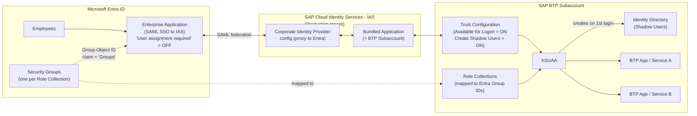
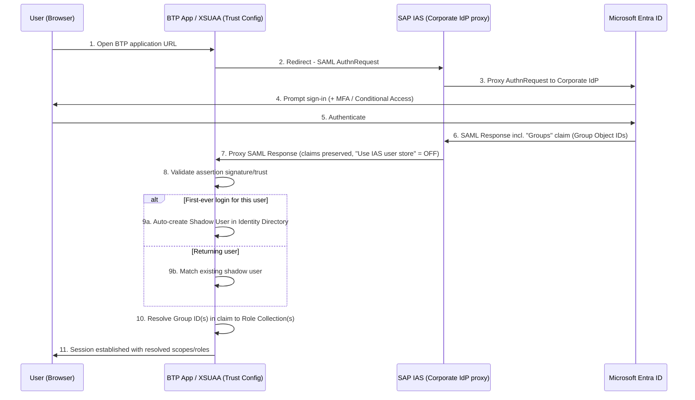
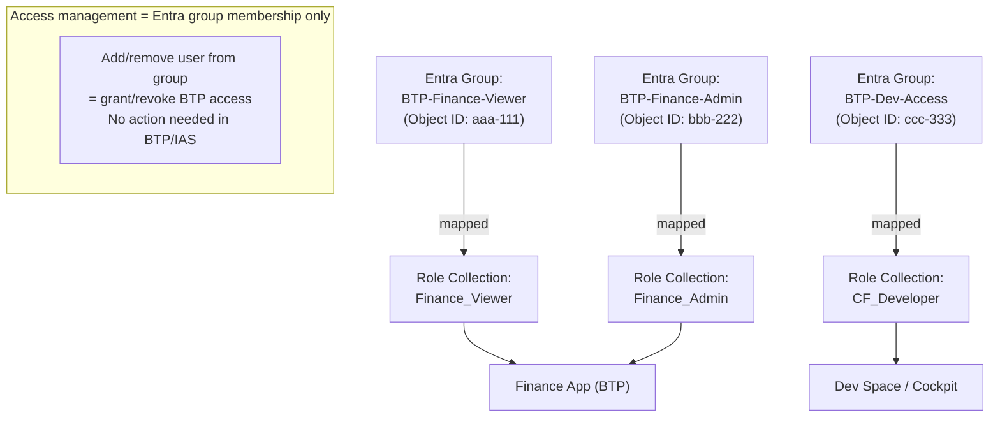

# Microsoft Entra ID → SAP BTP: Federated SSO with Group-Based Authorization (Shadow Users)

> **Scenario scope:** This note covers the *federation-only* pattern — no user provisioning into SAP BTP. Users authenticate via SSO from Microsoft Entra ID, BTP creates a **shadow user** automatically on first login, and access to specific services/roles is controlled entirely through **Entra security group membership mapped to BTP Role Collections**. Pre-provisioning users via IPS/SCIM is intentionally out of scope for this document.

---

## Table of Contents

- [1. Overview](#1-overview)
- [2. Architecture](#2-architecture)
- [3. Key Concepts](#3-key-concepts)
- [4. Design Decisions & Rationale](#4-design-decisions--rationale)
- [5. Tutorial: Step-by-Step Setup](#5-tutorial-step-by-step-setup)
- [6. Use Cases](#6-use-cases)
- [7. When This Pattern Does *Not* Fit](#7-when-this-pattern-does-not-fit)
- [8. Operational Considerations & Gotchas](#8-operational-considerations--gotchas)
- [9. References & Resources](#9-references--resources)

---

## 1. Overview

Enterprises that treat **Microsoft Entra ID as the authoritative identity source** commonly need a way to let employees single sign-on into SAP Business Technology Platform (BTP) applications without maintaining a second, manually managed user store in SAP.

This pattern achieves that using three building blocks:

1. **Federated authentication** — Entra ID is the identity provider; no passwords are ever created or stored in SAP.
2. **Shadow users** — BTP automatically creates a minimal user record in its Identity Directory the first time a federated user logs in. No user is provisioned in advance.
3. **Group-based authorization** — Access to specific BTP services/apps and the roles a user gets within them is driven entirely by **Entra security group membership**, mapped to **BTP Role Collections**. Nothing is manually assigned to individual users inside BTP.

The net effect: granting or revoking access to a BTP application is just an Entra group membership change — no SAP-side administration required for day-to-day access management.

---

## 2. Architecture

### 2.1 Component / Trust Diagram

SAP's own recommendation is to **not** federate Entra directly to BTP/XSUAA, but to route the trust through **SAP Cloud Identity Services – Identity Authentication (IAS)** acting as a SAML proxy. This centralizes the federation config once in IAS instead of repeating it per BTP subaccount.

**Key architectural rule:** an entire BTP **subaccount** is a single "Bundled Application" from IAS's point of view. Trust, branding, and access settings apply subaccount-wide — so group applications with similar identity requirements into the same subaccount.

### 2.2 Login / Authentication Sequence

### 2.3 Authorization Model

---

## 3. Key Concepts

| Concept | Description |
|---|---|
| **IAS (Identity Authentication Service)** | Part of SAP Cloud Identity Services; acts as the SAML proxy/broker between Entra ID and BTP. Every BTP subaccount is represented in IAS as a "Bundled Application." |
| **Trust Configuration (BTP)** | The SAML trust relationship a BTP subaccount has with an identity provider (default: SAP ID Service; here: IAS). Controls whether the IdP is "Available for User Logon" and whether shadow users are auto-created. |
| **Shadow User** | A minimal user record auto-created in the BTP Identity Directory the first time a federated user signs in successfully, when "Create Shadow Users During Logon" is enabled on the trust config. No password or manual pre-creation needed. |
| **Group Claim (`Groups`)** | A SAML assertion attribute Entra emits containing the Object ID(s) of security groups the user belongs to (scoped to only those groups assigned to the Enterprise Application, to stay under Entra's 150-group SAML limit). |
| **Role Collection** | The BTP authorization construct that bundles one or more roles from one or more apps. Can be mapped to *users*, or — as in this pattern — to *identity provider groups*. |
| **"User assignment required" (Entra)** | An Enterprise Application setting, ON by default for SAML apps. This pattern turns it **OFF**, since Entra cannot see which specific BTP app/subaccount a user is heading to once IAS is proxying — so Entra-side authorization here would only ever be all-or-nothing across all of BTP. |
| **Group Object ID vs. display name** | The mapping in BTP uses the Entra group's immutable Object ID (GUID), never the display name, because names can be renamed or reused for an unrelated group later — a security risk if authorization were tied to the name. |

---

## 4. Design Decisions & Rationale

| Decision | Why |
|---|---|
| Federate through **IAS**, not directly Entra→BTP/XSUAA | Centralizes trust config once instead of per-subaccount; enables IAS features like risk-based authentication; single place to manage certificate rollovers for multiple subaccounts. |
| **Disable** "User assignment required" on the Entra Enterprise App | Prevents two disconnected places (Entra + BTP) from holding partially-overlapping authorization data, which causes silent lockouts when one side is updated and the other isn't. |
| Authorize via **groups → Role Collections**, not **user → Role Collection** | Assigning a *user* directly requires that user to already exist as a shadow account in BTP — but with pure federation (no provisioning), that shadow account may not exist yet at assignment time. Group-based mapping has no such ordering dependency: the mapping (group → role collection) is configured once, independent of whether any given user has ever logged in. |
| Use **Group Object ID**, not group name, in the claim/mapping | Object IDs are globally unique and immutable; names can be changed or reused, which is a security and audit risk. |
| Enable **"Create Shadow Users During Logon"** | Removes any need for pre-provisioning; access is entirely self-service via group membership, and the BTP-side user record appears automatically on first login. |
| Limit group claims to **"Groups assigned to the application"** | Keeps the SAML assertion small and avoids Entra's 150-group claim ceiling; also is a natural place to curate exactly which groups are relevant to this BTP subaccount. |
| Use the **production IAS tenant** for all end-user auth, even against dev/test BTP subaccounts | IAS is the single place federation is configured; duplicating it across tenants risks inconsistent end-user access between environments. |

---

## 5. Tutorial: Step-by-Step Setup

### Step 1 — Create Entra Security Groups

Create one Entra ID security group per BTP Role Collection you want to expose, e.g.:

- `BTP-Finance-Viewer`
- `BTP-Finance-Admin`
- `BTP-Dev-Access`

> Naming convention tip: prefix with the BTP subaccount or app name so groups are easy to audit later (`BTP-<App/Subaccount>-<RoleLevel>`).

### Step 2 — Configure the Enterprise Application in Entra

1. In Entra ID, locate (or create, if not yet onboarded) the Enterprise Application representing the SAML trust to IAS.
2. Under **Properties**, set **"User assignment required?"** to **No**.
3. Under **Single sign-on → Attributes & Claims**, add a **Group Claim**:
   - Source attribute: **Group ID**
   - Claim name: `Groups` (exact casing)
   - Which groups to return: **"Groups assigned to the application"**
4. Go to **Users and groups** on the Enterprise App and add only the groups you actually want emitted as claims (this both scopes the claim and satisfies step 3's filter).

### Step 3 — Configure IAS as Corporate Identity Provider

1. In IAS, set up Microsoft Entra ID as a **Corporate Identity Provider** (SAML federation) — see SAP's tutorial in the references below.
2. On the Corporate IdP config, under Identity Federation, **disable "Use Identity Authentication user store"** — otherwise the `Groups` claim from Entra will be stripped before reaching BTP.
3. On the "Bundled Application" (representing your BTP subaccount), under Conditional Authentication, set the **Default Authenticating Identity Provider** to this Corporate IdP so users go straight to Entra without an IdP-selection screen.

### Step 4 — Configure Trust in BTP

1. In the BTP subaccount's Security → Trust Configuration, add IAS as the trusted identity provider (import IAS's SAML metadata XML).
2. Enable:
   - **Available for User Logon**
   - **Create Shadow Users During Logon**
3. (Optional but recommended) On the default **SAP ID Service** trust configuration, disable "Available for User Logon" so users are never prompted to choose an identity provider.

### Step 5 — Map Role Collections to Groups

1. In BTP, open each Role Collection that should be tied to a group.
2. Add a mapping: Identity Provider = your IAS trust configuration; Attribute = `Groups`; Value = the **Object ID** of the corresponding Entra group.
3. Repeat per Role Collection / group pair.

### Step 6 — Test End-to-End

1. Add a test user to `BTP-Finance-Viewer` in Entra.
2. Have the user open the BTP application URL cold (no prior BTP account).
3. Confirm: redirect to Entra → sign-in/MFA → redirect back → shadow user appears in BTP's Identity Directory → user lands with exactly the `Finance_Viewer` role collection's permissions.
4. Remove the user from the group and confirm access is revoked on next login (SAML is not real-time revocation — session/token lifetimes apply until re-authentication).

---

## 6. Use Cases

- **Multiple BTP subaccounts / Fiori-based landscapes** where dozens of apps need consistent SSO without per-app SAP user administration.
- **Fast-changing project or contractor access** — access to a BTP service can be granted/revoked purely by adding/removing an Entra group membership, with no SAP-side ticket or admin action.
- **Decentralized app teams, centralized identity governance** — application teams own their Role Collections and simply tell IAM which Entra group maps to which collection; IAM keeps control of group membership (optionally via Entra ID Governance Access Packages for self-service requests + approval).
- **Low-friction onboarding** for employees who only need access to BTP-hosted line-of-business apps (not systems with native business-role objects, see below) — day-one access with zero pre-provisioning.
- **Organizations standardizing on "Entra ID as authoritative identity source"** and wanting to minimize the number of places user lifecycle and access data must be reconciled.

---

## 7. When This Pattern Does *Not* Fit

Flagging this so it isn't accidentally over-applied — worth a separate design note if it becomes relevant:

- **SAP systems with native business-role/user objects** — e.g., SAP BTP ABAP Environment, SuccessFactors, S/4HANA Cloud, Ariba — require the user to actually exist with business attributes (cost center, company code, etc.) *before* role assignment can happen. Shadow-user-at-login isn't sufficient there; those need real provisioning (Entra → IPS → IAS/target) instead.
- **License-counting or joiner-mover-leaver automation** that needs to know exactly which users are enabled *before* first login (shadow users only appear after a successful login).
- Any requirement for **near-real-time deprovisioning** — SAML federation revokes access on next re-authentication, not instantly.

---

## 8. Operational Considerations & Gotchas

- **SAML assertion / claim size limits:** Entra caps SAML group claims at 150 groups by default, and SAP enforces limits on Cloud Foundry Role Collection name length and the number of collections proxied via IAS groups (see SAP Note 2732890). Keep the "Groups assigned to the application" filter tight.
- **Certificate rollover:** there are *two* separate SAML trust hops — Entra↔IAS and IAS↔BTP — each with its own X.509 signing/encryption certs and expiration dates. IAS and BTP both require a manual metadata XML re-upload (no dynamic metadata endpoint support), so build a tracked renewal process and route expiry notifications to a shared mailbox, not an individual.
- **Subaccount = one IAS "Bundled Application":** don't mix apps with different identity/branding/trust requirements into the same subaccount.
- **Use the production IAS tenant** for all real end-user authentication, even when the target BTP environment is dev/test — keep other IAS tenants for isolated identity-config testing only.
- **Group ID, not group name**, everywhere in the mapping — protects against silent authorization changes from group renames/recreation.

---

## 9. References & Resources

**Microsoft / Entra documentation**
- [Scenario – Using Microsoft Entra ID to secure access to SAP platforms and applications](https://learn.microsoft.com/en-us/azure/sap/workloads/scenario-azure-first-sap-identity-integration) — primary source for this design (federation, shadow users, group→role collection recommendations)
- [Microsoft Entra SSO integration with SAP Cloud Identity Services tutorial](https://learn.microsoft.com/en-us/entra/identity/saas-apps/sap-hana-cloud-platform-identity-authentication-tutorial)
- [Plan deploying Microsoft Entra for user provisioning with SAP source and target applications](https://learn.microsoft.com/en-us/entra/identity/app-provisioning/plan-sap-user-source-and-target)
- [Manage access to your SAP applications (Entra ID Governance)](https://learn.microsoft.com/en-us/entra/id-governance/sap)
- [Add group claims to tokens for SAML applications](https://learn.microsoft.com/en-us/entra/identity/hybrid/connect/how-to-connect-fed-group-claims#add-group-claims-to-tokens-for-saml-applications-using-sso-configuration)
- [Migrate identity management scenarios from SAP IDM to Microsoft Entra](https://learn.microsoft.com/en-us/entra/id-governance/scenarios/migrate-from-sap-idm)

**SAP documentation**
- [SAP Cloud Identity Services – Identity Authentication overview](https://pages.community.sap.com/topics/cloud-identity-services/identity-authentication)
- [Trust Configurations in SAP BTP](https://help.sap.com/viewer/65de2977205c403bbc107264b8eccf4b/Cloud/en-US/cb1bc8f1bd5c482e891063960d7acd78.html)
- [Assigning Role Collections to Users or User Groups](https://help.sap.com/viewer/65de2977205c403bbc107264b8eccf4b/Cloud/en-US/51acfc82c0c54db59de0a528f343902c.html)
- [Shadow Users – SAP Help Portal](https://help.sap.com/docs/sap-api-management/sap-api-management/shadow-users)
- [SAP tutorial: Connect Microsoft Entra ID to IAS in federation (proxy) mode](https://developers.sap.com/tutorials/cp-ias-azure-ad.html)
- [SAP Note 2732890 — SAML assertion / role collection limits](https://me.sap.com/notes/2732890) *(requires SAP for Me login)*

**Community write-ups (design walkthroughs / real implementations)**
- [Understanding SSO in SAP BTP with IAS and Microsoft Entra ID (SAP Community)](https://community.sap.com/t5/technology-blog-posts-by-members/understanding-single-sign-on-sso-in-sap-btp-with-ias-and-microsoft-entra-id/ba-p/14386267)
- [IAM with Microsoft Entra, Part I: Managing access to SAP BTP (SAP Community)](https://community.sap.com/t5/technology-blog-posts-by-members/identity-and-access-management-with-microsoft-entra-part-i-managing-access/ba-p/13873276) — includes the Access Packages / Entitlement Management pattern for self-service group requests
- [IAM with Microsoft Entra, Part II: Provisioning to BTP and S/4HANA (SAP Community)](https://community.sap.com/t5/technology-blog-posts-by-members/identity-and-access-management-with-microsoft-entra-part-ii-provisioning-to/ba-p/13990927)
- [Shadow user in BTP — discussion thread (SAP Community)](https://community.sap.com/t5/technology-q-a/shadow-user-in-btp/qaq-p/13674383)

---

*Document scope note: this note deliberately excludes the SAP Cloud Identity Services – Identity Provisioning (IPS) pattern for pre-provisioning users and syncing groups into systems with native business-role models (e.g., BTP ABAP Environment, SuccessFactors, S/4HANA Cloud). That is a separate design and should be documented independently when/if those target systems enter scope.*