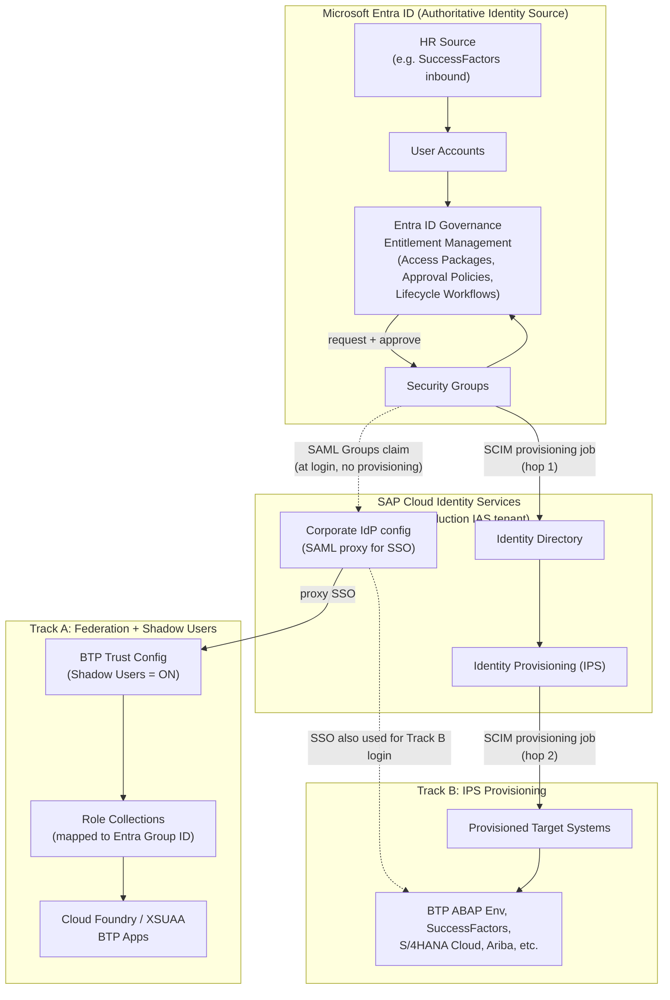
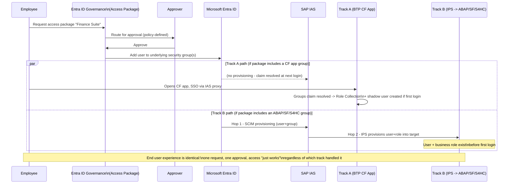
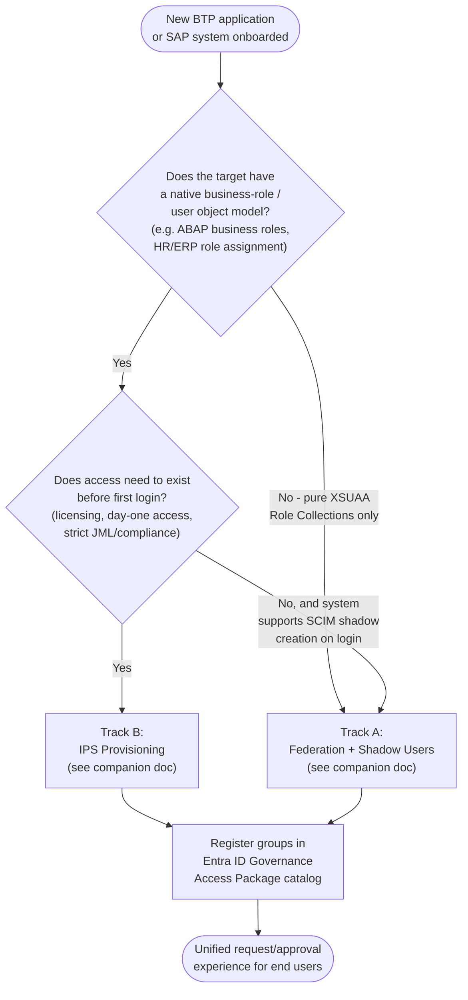

# Microsoft Entra ID → SAP BTP: Hybrid Architecture (Federation + Provisioning, Unified by Governance)

> **Scenario scope:** This note describes the **hybrid** pattern most enterprises actually converge on — running the [federation/shadow-user pattern](./entra-btp-sso-shadow-users.md) and the [IPS provisioning pattern](./entra-btp-ips-provisioning.md) **side by side**, segmented by what each target SAP system requires, and tied together under a single **Microsoft Entra ID Governance** layer (Access Packages, approval workflows, Lifecycle Workflows) so end users have one consistent request experience regardless of which mechanism operates behind the scenes.

---

## Table of Contents

- [1. Overview](#1-overview)
- [2. Architecture](#2-architecture)
- [3. Key Concepts](#3-key-concepts)
- [4. Design Decisions & Rationale](#4-design-decisions--rationale)
- [5. Tutorial: Step-by-Step Setup](#5-tutorial-step-by-step-setup)
- [6. Use Cases](#6-use-cases)
- [7. When Hybrid Is *Not* Worth the Complexity](#7-when-hybrid-is-not-worth-the-complexity)
- [8. Operational Considerations & Gotchas](#8-operational-considerations--gotchas)
- [9. References & Resources](#9-references--resources)

---

## 1. Overview

Neither pure pattern covers a real enterprise SAP landscape on its own:

- **Federation + shadow users** (Track A) is lightweight and perfect for Cloud Foundry/XSUAA-based BTP apps, but doesn't work for systems that need a persisted user object with business attributes *before* login (ABAP Environment, SuccessFactors, S/4HANA Cloud, Ariba).
- **IPS provisioning** (Track B) handles those systems correctly, but is unnecessary integration overhead for simple Role-Collection-only apps.

The pattern that actually shows up in production is: **use both, routed per target system, but present one unified access-request experience to end users** via Microsoft Entra ID Governance. A business user requesting "access to the Finance app" shouldn't need to know or care whether that request results in a SAML group claim resolved at login, or a SCIM provisioning job running overnight — they just request an Access Package and get approved.

---

## 2. Architecture

### 2.1 Unified Hybrid Architecture

**Routing rule of thumb:** if the target system's authorization model is entirely expressed as BTP Role Collections and it has no native business-role/user object → **Track A**. If the target system requires a persisted, attribute-rich user object ahead of login (ABAP Environment, HCM/HR systems, ERP-style role models) → **Track B**. Everything is still fronted by the *same* Entra groups and the *same* Entra ID Governance catalog — the routing decision only affects what happens technically behind an access grant, not how the user requests it.

### 2.2 Unified Access Request Lifecycle (Sequence)

### 2.3 Decision Flow for Classifying a New Target System

---

## 3. Key Concepts

| Concept | Description |
|---|---|
| **Track A / Track B** | Shorthand used in this note: Track A = federation + shadow users (no pre-provisioning); Track B = IPS provisioning (pre-provisioned users/groups). Both are documented in full in their own companion notes. |
| **Entra ID Governance – Entitlement Management** | The feature that lets administrators bundle resources (security groups, applications) into **Access Packages**, define who can request them, approval policies, and expiration/review rules — the single front door for both tracks. |
| **Access Package** | A bundle of one or more resources (e.g., the Entra group that maps to a Track A Role Collection, *and* the Entra group that flows into a Track B provisioning pipeline) that a user requests as a single unit. |
| **Lifecycle Workflows** | Entra ID Governance capability to automate tasks tied to Join/Move/Leave events (e.g., auto-add to an access package on hire, auto-remove on termination, trigger a welcome email or a Logic App callout). |
| **Logic Apps extensibility** | Both Entitlement Management and Lifecycle Workflows can call out to Azure Logic Apps at key points (request submitted, assignment granted, assignment removed) — used to trigger custom SAP-side tasks beyond what native provisioning covers. |
| **SAP Cloud Identity Access Governance (IAG) integration (Preview)** | An emerging deeper integration (announced at SAP Sapphire 2026) letting SAP IAG business roles be published directly into the Entra entitlement catalog, with approvals and Separation-of-Duties (SoD) enforcement handled natively across the Entra↔SAP boundary — see [§4](#4-design-decisions--rationale) and [§9](#9-references--resources) for status and links. |
| **Single IAS production tenant** | Both tracks share the same IAS tenant as their federation broker and (for Track B) identity source/target — this is what allows one certificate-management process and one place to reason about identity to serve both tracks. |

---

## 4. Design Decisions & Rationale

| Decision | Why |
|---|---|
| **Route by target-system capability, not by organizational preference** | The technical constraint is real: systems with native business-role objects (ABAP Environment, SuccessFactors, S/4HANA Cloud) cannot rely on shadow users. Making the routing decision a checklist (see [2.3](#23-decision-flow-for-classifying-a-new-target-system)) instead of an ad-hoc call per project avoids inconsistent architecture across teams. |
| **Share a single IAS production tenant across both tracks** | Both the SAML proxy (SSO) and the Hop-1/Hop-2 provisioning pipeline live in the same IAS tenant, which means one certificate-rollover process, one place to check federation health, and one Identity Directory as the meeting point for both tracks. |
| **Put the request/approval experience in Entra ID Governance, not in either SAP system** | End users and approvers should not need to know which track their access maps to. Access Packages abstract that away — a single catalog entry can bundle a Track A group and a Track B group together (e.g., "Finance Suite" package granting both the BTP Finance app and the S/4HANA Cloud Finance business role in one request). |
| **Automate JML with Lifecycle Workflows where possible, on top of both tracks** | Track A revokes access lazily (next login/session), Track B revokes on the next provisioning job cycle — neither is instantaneous. Lifecycle Workflows triggered directly off HR termination events (rather than waiting on a provisioning job schedule) tightens this gap for both tracks simultaneously. |
| **Track the SAP IAG integration (Preview) as a future consolidation point, not a current dependency** | As of the SAP Sapphire 2026 announcements, Microsoft and SAP are deepening this further — publishing SAP business roles directly into the Entra entitlement catalog with native SoD enforcement, and even a private-preview connector back to on-prem SAP GRC Access Control. This could eventually reduce the amount of custom Track B integration work, but it's a preview capability today and shouldn't be load-bearing in a production design yet. |
| **Document the routing decision per target system explicitly (an ADR-style record)** | Without a written record of "why does System X use Track A and System Y use Track B," teams tend to re-litigate this per project or copy the wrong pattern into a new system that doesn't fit it. |

---

## 5. Tutorial: Step-by-Step Setup

### Step 1 — Establish the Shared Foundation

1. Stand up (or confirm) a single **production IAS tenant** federated with Microsoft Entra ID as a Corporate Identity Provider (see the [federation doc, Step 3](./entra-btp-sso-shadow-users.md#step-3--configure-ias-as-corporate-identity-provider) for detail).
2. Put a certificate-rollover process in place up front — it's shared infrastructure for both tracks, so get it right once.

### Step 2 — Inventory and Classify Target Systems

For every BTP application / SAP system in scope, run it through the [decision flow](#23-decision-flow-for-classifying-a-new-target-system) and record the outcome (Track A or Track B) along with the reasoning. Keep this as a living document — it's your architecture's source of truth for "why does this system work this way."

### Step 3 — Implement Track A for Qualifying Systems

Follow the [federation + shadow-user tutorial](./entra-btp-sso-shadow-users.md#5-tutorial-step-by-step-setup) per subaccount: Entra groups → group claim → BTP trust config with shadow users enabled → Role Collection mapping.

### Step 4 — Implement Track B for Qualifying Systems

Follow the [IPS provisioning tutorial](./entra-btp-ips-provisioning.md#5-tutorial-step-by-step-setup) per target: choose Hop-1 option, configure IPS Hop-2 target/proxy system, map groups to business roles, configure SSO separately for authentication.

### Step 5 — Build the Unified Governance Catalog

1. In Microsoft Entra ID Governance, create one or more **Catalogs** representing logical business areas (e.g., "Finance Suite," "Developer Access").
2. Create **Access Packages** inside each catalog, bundling the relevant resources:
   - The Track A security group(s) that map to Role Collections.
   - The Track B security group(s) that flow into IPS provisioning.
   - (Optionally) other non-SAP resources like a SharePoint site or Teams the same business function needs.
3. Define request/approval policies per package: who can request, who approves, whether it's time-bound, and whether periodic access reviews are required.

### Step 6 — Layer in Lifecycle Workflows for JML Automation

1. Configure **Lifecycle Workflows** for hire/move/leave events sourced from your HR system inbound sync.
2. On hire: auto-assign the relevant Access Package(s) based on attributes (department, job role) rather than requiring a manual request, where policy allows.
3. On termination: trigger immediate removal from the underlying groups — this is what tightens the "next login" (Track A) / "next job cycle" (Track B) revocation gap.
4. Where SAP-side actions are needed beyond group removal, use the Logic Apps extensibility point to call out to a custom workflow.

### Step 7 — (Forward-Looking) Evaluate SAP IAG Integration

If your SAP landscape includes SAP Cloud Identity Access Governance or you're still on SAP GRC Access Control, track the Microsoft Entra ↔ SAP IAG integration (public preview as of SAP Sapphire 2026) as a candidate to consolidate SAP business-role governance directly into the same Entra entitlement catalogs used in Step 5 — reducing the amount of bespoke Track B mapping work over time.

### Step 8 — Test End-to-End Across Both Tracks

1. Create a test Access Package bundling one Track A group and one Track B group.
2. Request → approve → verify: Track A access appears at next login (with shadow user creation on first login); Track B access appears after the next provisioning job cycle, before any login.
3. Remove the assignment (or let it expire) and verify revocation timing on both tracks matches expectations set in [§8](#8-operational-considerations--gotchas).

---

## 6. Use Cases

- **Full enterprise SAP landscape** spanning both Cloud Foundry BTP apps and systems like S/4HANA Cloud, SuccessFactors, or the BTP ABAP Environment, where a single employee's "start date" access needs to span both.
- **Self-service, business-friendly access requests** — non-technical employees request an access package by name ("Finance Suite") without needing to understand SAP's identity mechanics.
- **Compliance-heavy environments** requiring Separation-of-Duties checks, access reviews, and audit trails across a mixed SAP landscape — centralizing this in Entra ID Governance avoids maintaining separate approval/audit tooling per SAP system.
- **Organizations migrating off SAP Identity Management (IDM)** — this hybrid model is explicitly the replacement architecture Microsoft and SAP jointly recommend as SAP IDM approaches end of maintenance.
- **Phased modernization** — start with Track A only (simplest), add Track B as ABAP/SuccessFactors/S4HC systems come into scope, then layer governance and (eventually) SAP IAG integration as the program matures.

---

## 7. When Hybrid Is *Not* Worth the Complexity

- **Small or single-purpose landscapes** — if you only ever have Cloud Foundry-based BTP apps, just implement Track A; there's nothing to "hybridize."
- **Landscapes entirely composed of systems needing pre-provisioning** — if every target requires IPS provisioning, Track A adds nothing; implement Track B alone.
- **No appetite/license for Microsoft Entra ID Governance** — the unifying value of this pattern is largely the shared Access Package experience; without Entra ID Governance (P2/Governance licensing), you're really just running Track A and Track B independently with manual group management on both sides, which is still valid but isn't really "hybrid" in the sense described here.
- **Early-stage / proof-of-concept work** — introduce the governance layer once you have more than a couple of Access Packages to manage; for a handful of test users, direct group assignment is simpler.

---

## 8. Operational Considerations & Gotchas

- **Revocation timing differs by track** — Track A revokes on next re-authentication; Track B revokes on the next provisioning job run. Document these differing SLAs so compliance/audit expectations are set correctly, and use Lifecycle Workflows to tighten both where termination speed matters.
- **Avoid duplicate or conflicting groups** — with two tracks and a governance catalog on top, it's easy to end up with overlapping groups that both grant access to the same resource through different paths. Keep the classification record from Step 2 authoritative.
- **Combined monitoring surface** — you now need to watch SSO/federation health (shared IAS tenant), IPS provisioning job status (Track B), *and* Access Package approval SLAs (governance layer) — treat these as three related but distinct monitoring domains.
- **Governance catalog sprawl** — as more Access Packages are created, review and prune regularly; entitlement management can itself become an unmanaged system if catalogs aren't owned and reviewed.
- **Preview-feature risk** — the SAP IAG integration and the on-prem SAP AC connector are (as of SAP Sapphire 2026) public and private preview respectively; don't build a hard dependency on them for a production timeline without confirming GA status and support terms first.
- **Certificate rollover is still a single shared risk** — because both tracks route through the same IAS tenant, a lapsed certificate on the Entra↔IAS or IAS↔BTP hop breaks *both* tracks simultaneously, not just one.
- **Cost/licensing** — Microsoft Entra ID Governance (Entitlement Management, Lifecycle Workflows) requires appropriate Entra licensing (P2/Governance tier); factor this into the business case for the unified layer versus running the two tracks independently.

---

## 9. References & Resources

**Microsoft / Entra documentation**
- [Scenario – Using Microsoft Entra ID to secure access to SAP platforms and applications](https://learn.microsoft.com/en-us/azure/sap/workloads/scenario-azure-first-sap-identity-integration)
- [Manage access to your SAP applications – Microsoft Entra ID Governance](https://learn.microsoft.com/en-us/entra/id-governance/sap)
- [What is entitlement management? – Microsoft Entra ID Governance](https://learn.microsoft.com/en-us/entra/id-governance/entitlement-management-overview)
- [Microsoft Entra SAP IAG integration (Preview)](https://learn.microsoft.com/en-us/entra/id-governance/entitlement-management-sap-integration)
- [Migrate identity management scenarios from SAP IDM to Microsoft Entra (Lifecycle Workflows, JML)](https://learn.microsoft.com/en-us/entra/identity/app-provisioning/migrate-from-sap-idm)
- [Plan deploying Microsoft Entra for user provisioning with SAP source and target applications](https://learn.microsoft.com/en-us/entra/identity/app-provisioning/plan-sap-user-source-and-target)
- [Automate user provisioning and deprovisioning into SAP BTP with Microsoft Entra ID](https://learn.microsoft.com/en-us/entra/identity/saas-apps/sap-btp-provisioning-tutorial)

**Microsoft/SAP announcements**
- [SAP on Azure Product Announcements Summary – SAP Sapphire 2026 (Microsoft Community Hub)](https://techcommunity.microsoft.com/blog/sapapplications/sap-on-azure-product-announcements-summary-%E2%80%93-sap-sapphire-2026/4517634) — SAP IAG integration, day-zero account discovery, SAP AC connector (private preview)

**Community write-ups (design walkthroughs / real implementations)**
- [IAM with Microsoft Entra, Part I: Managing access to SAP BTP (SAP Community)](https://community.sap.com/t5/technology-blog-posts-by-members/identity-and-access-management-with-microsoft-entra-part-i-managing-access/ba-p/13873276) — introduces the Access Package request/approval workflow on top of Track A
- [IAM with Microsoft Entra, Part II: Provisioning to BTP and S/4HANA (SAP Community)](https://community.sap.com/t5/technology-blog-posts-by-members/identity-and-access-management-with-microsoft-entra-part-ii-provisioning-to/ba-p/13990927) — extends the same Access Package model over Track B, fully automating lifecycle management
- [IAM with Microsoft Entra, Part III: SuccessFactors and Role Provisioning (SAP Community)](https://community.sap.com/t5/technology-blog-posts-by-members/identity-and-access-management-with-microsoft-entra-part-iii-successfactors/ba-p/14233747) — HR-driven (SuccessFactors as source of authority) end-to-end scenario feeding both tracks
- [SAP + Microsoft Entra: The Future of Identity Governance](https://www.sapsecurityexpert.com/sap-cis/sap-microsoft-entra-identity-governance) — overview of the SAP IAG and on-prem GRC AC connector direction

**Companion documents in this set**
- [`entra-btp-sso-shadow-users.md`](./entra-btp-sso-shadow-users.md) — Track A in full detail
- [`entra-btp-ips-provisioning.md`](./entra-btp-ips-provisioning.md) — Track B in full detail

---

*Document scope note: this note assumes both companion documents as prerequisites and focuses only on the routing decision, the shared foundation, and the governance layer that ties them together. Implementation detail for each individual track lives in its own document.*