# Entra ID SSO and Access Governance for SAP BTP via Cloud Identity Services

> This guide sets up single sign-on from Microsoft Entra ID to SAP BTP, with SAP Cloud Identity Services (IAS) acting as an OIDC proxy. Authorization stays in Entra: a user's membership in an Entra security group reaches BTP as a `groups` claim and is mapped to a BTP role collection. That membership is itself governed by an Entra **access package**, so users request access and an approver grants it without anyone touching BTP. SAP Business Application Studio (BAS) is used as the example application.

## At a glance

| | |
|---|---|
| **Goal** | Entra users sign in to BTP apps with their corporate account; BTP roles are granted by approving an Entra access package. |
| **Systems** | Microsoft Entra ID (P2 / ID Governance), SAP Cloud Identity Services – Identity Authentication, SAP BTP subaccount (Cloud Foundry) |
| **Estimated time** | 60–90 minutes |
| **Roles required** | Entra: Global Administrator (or Application Administrator + Identity Governance Administrator). IAS: tenant administrator. BTP: Subaccount Administrator. |
| **Out of scope** | User provisioning into the IAS Identity Directory (SCIM / Identity Provisioning), SAML between Entra and IAS, the IAS Authorization Management Service. |

## Architecture

### Components and trust relationships

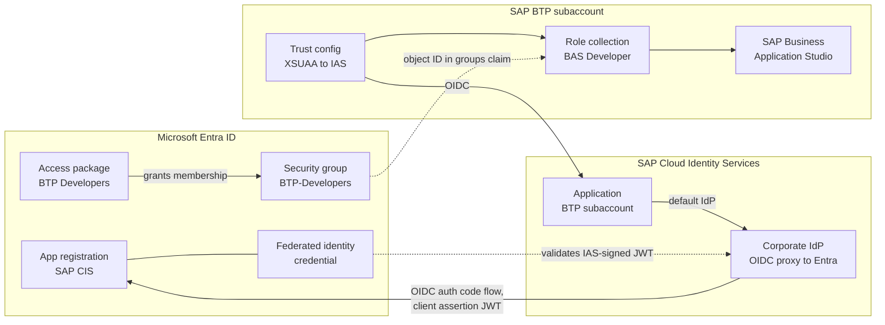

**Microsoft Entra ID** is the source of truth for identities *and* for who is allowed to do what. The **app registration** represents the IAS tenant as an OIDC client. It controls the redirect URIs, which claims go into tokens (the `groups` claim in particular) and which API permissions IAS may request. The **federated identity credential** lets IAS authenticate to Entra with a JWT signed by its own key, so there's no client secret to rotate. The **security group** is the authorization unit, and the **access package** is the governed, approval-based way users get into that group.

**SAP Cloud Identity Services (IAS)** is already the trusted identity provider for the BTP subaccount. Here it takes a second role: it becomes an **OIDC proxy**. The Entra tenant is registered as a **corporate identity provider** and set as the default authenticating IdP for the BTP subaccount application. IAS forwards authentication to Entra and passes the `groups` claim on to BTP through an attribute mapping.

**SAP BTP** trusts IAS (established when the subaccount was connected to Cloud Identity Services). The BTP authorization service (XSUAA) maps the incoming `groups` values to **role collections**. It creates a *shadow user* for each person on first sign-in; no user provisioning into BTP is needed.

> [!NOTE]
> **This is a federated setup, not a provisioning one.** Users and group memberships live only in Entra and travel to BTP inside the token at every sign-in. There's no SCIM job and no copy of users in the IAS Identity Directory. That keeps it simple, and it works for XSUAA-based BTP applications. Applications that use the IAS Authorization Management Service need users replicated into the Identity Directory; that's covered in Part II of the upstream blog series.

### SSO authentication sequence

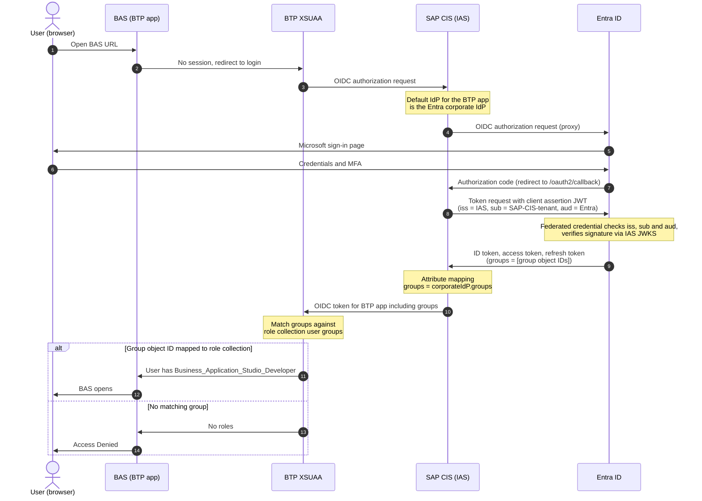

The rest of this guide builds the chain in this order: Entra trusts IAS (Part 1), IAS trusts and proxies to Entra (Part 2), the round trip is validated (Part 3), group membership is mapped to a role (Part 4), membership is governed (Part 5), and the whole flow is tested end to end (Part 6).

## Prerequisites

- [ ] **SAP BTP subaccount** with **SAP Business Application Studio** subscribed. The subscription creates the `Business_Application_Studio_Developer` role collection used in Part 4.
- [ ] **SAP Cloud Identity Services** tenant with admin access, set up as the subaccount's trusted IdP. If you don't have one yet:
  1. In the subaccount, go to **Services → Instances and Subscriptions → Create** and subscribe to **Cloud Identity Services** (plan: *default*).

     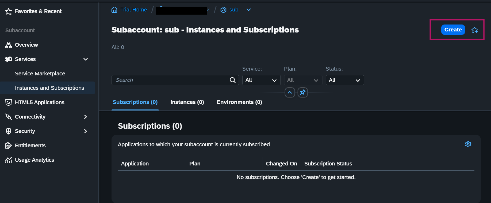

  2. Go to **Security → Trust Configuration → Establish Trust** and select the IAS tenant. Without this trust, BTP won't accept tokens from IAS and the role collection mapping in Part 4 has no identity provider to point at.
- [ ] **Microsoft Entra ID P2** with **Entra ID Governance** (needed for access packages). A Microsoft 365 E5 developer tenant with a Governance trial works.
- [ ] **Two Entra test users**: a *requester* who will ask for BAS access, and an *approver* (usually your admin account).

## Values to collect

These values are created in one system and pasted into another. Keep a scratch file open while you work.

| Placeholder | Example / format | Where you get it | Where you use it |
|---|---|---|---|
| `<cis_tenant>` | `abc123xyz` | Your IAS admin console URL | Steps 1.4, 1.5 |
| `<cis_host>` | `abc123xyz.accounts.ondemand.com` (trial: `abc123xyz.trial-accounts.ondemand.com`) | IAS admin console URL | Steps 1.4, 1.5 |
| `<jwt_subject>` | `SAP-CIS-<cis_tenant>` | **You choose it**; it must be identical in both places | Steps 1.5 and 2.4 |
| `<entra_tenant_id>` | GUID | Entra → **Overview → Tenant ID** | Step 1.5 |
| `<client_id>` | GUID | App registration → **Overview → Application (client) ID** | Step 2.4 |
| `<oidc_metadata_url>` | `https://login.microsoftonline.com/<entra_tenant_id>/v2.0/.well-known/openid-configuration` | App registration → **Endpoints** | Step 2.3 |
| `<group_object_id>` | GUID | Entra group → **Overview → Object ID** | Step 4.2 |
| `<myaccess_link>` | `https://myaccess.microsoft.com/@<tenant>#/access-packages/<id>` | Access package after creation | Step 6.2 |
| `<bas_url>` | `https://<subaccount>.<region>.applicationstudio.cloud.sap/` | BTP → **Instances and Subscriptions** | Steps 6.1, 6.4 |

---

## Part 1 — Entra ID: register SAP Cloud Identity Services as an OIDC client

Entra needs to know about the IAS tenant before it will authenticate users on its behalf or issue tokens to it. Everything in this part sits on a single app registration.

### Step 1.1 — Create the app registration

**What:** A new app registration named `SAP CIS`, single tenant.
**Why:** Every OIDC client in Entra is an app registration. It holds the client ID, the allowed redirect URIs, the token configuration and the credentials that IAS uses.
**Role in the architecture:** This is the Entra side of the Entra ↔ IAS trust. Registering it also creates an **enterprise application** (service principal) with the same name, which is where user assignment is managed (Step 1.2).

1. In the [Entra admin center](https://entra.microsoft.com), go to **Entra ID → App registrations → New registration**.
2. **Name:** `SAP CIS` (or `SAP CIS (<cis_tenant>)` if you have several tenants).
3. **Supported account types:** *Single tenant only*.
4. Leave **Redirect URI** empty (it's added in Step 1.4) and click **Register**.

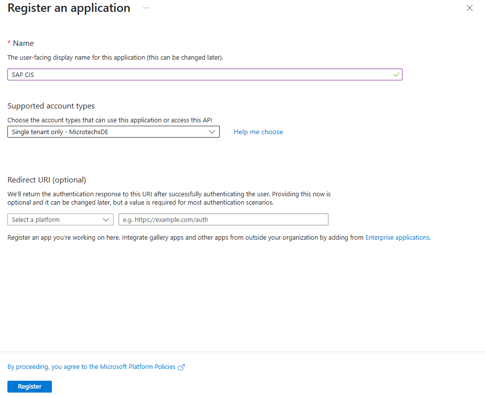

> [!NOTE]
> The upstream blog creates this from the Entra app gallery tile **SAP Cloud Identity Services** instead of a plain registration. The result is the same for SSO. The gallery app also adds a provisioning connector, so use it if you plan to add SCIM provisioning to the IAS Identity Directory later.

### Step 1.2 — Assign test users to the enterprise application

**What:** Assign the users (or groups) that may sign in through this app.
**Why:** The assignment decides who Entra lets use this client. If **Assignment required?** is set to *Yes* on the enterprise application's **Properties**, only assigned users can sign in to BTP through IAS.
**Role in the architecture:** This is a coarse gate on *authentication* ("may this person reach BTP through IAS at all"). It's separate from the fine-grained *authorization* that groups and role collections handle in Parts 4–5.

1. Go to **Entra ID → Enterprise apps** and open **SAP CIS**.
2. Select **Users and groups**.

   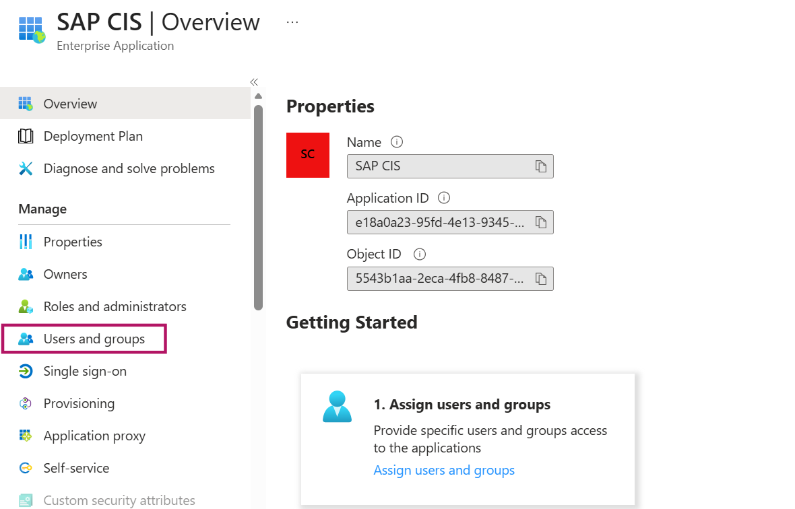

3. Click **Add user/group**, select your test users and click **Assign**.

   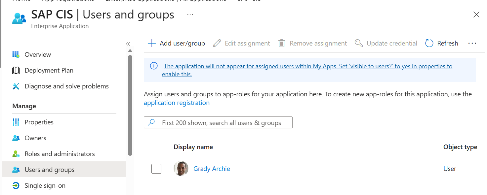

> [!TIP]
> Assignment required defaults to *No*, which means every user in the tenant can authenticate. Their access to BAS is still denied until they get the group membership. For production, set it to *Yes* and assign a broad group (such as all employees who use BTP) so the gate actually applies.

### Step 1.3 — Open the app registration from the enterprise application

**What:** Navigate from the enterprise application back to its app registration.
**Why:** The remaining settings (redirect URIs, credentials, token claims, permissions) belong to the app registration, not the enterprise application.
**Role in the architecture:** The enterprise application is the *instance* in your tenant, used for assignment and sign-in policy. The app registration is the *definition*, covering protocol and token settings.

1. In the enterprise application, select **Properties**.
2. Click the **application registration** link.

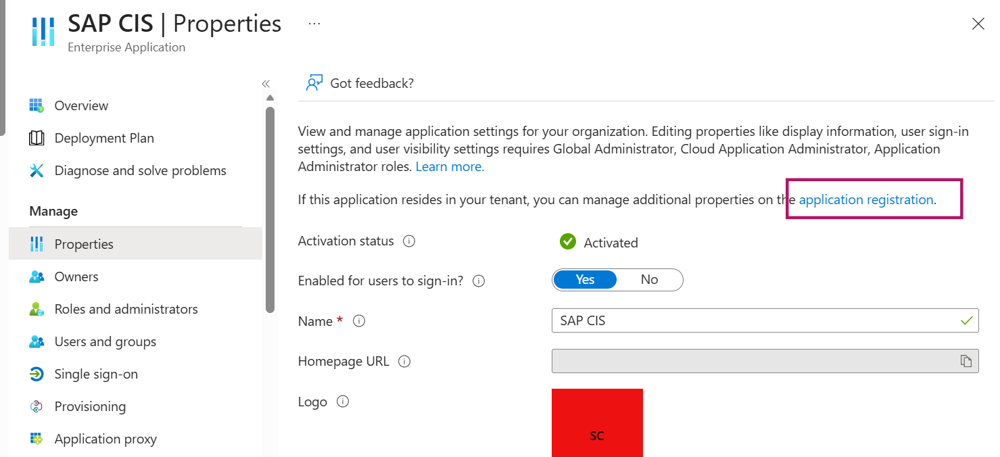

### Step 1.4 — Add the IAS redirect URIs

**What:** Two *Web* redirect URIs pointing at the IAS OIDC callback.
**Why:** Entra sends authorization codes only to redirect URIs registered on the client. Without them, sign-in fails with a redirect URI mismatch error.
**Role in the architecture:** This is where step 8 of the [SSO sequence](#sso-authentication-sequence) returns: Entra sends the user back to IAS with the authorization code. IAS tenants answer on two domains, so register both.

1. Select **Authentication (Preview) → Add Redirect URI**.

   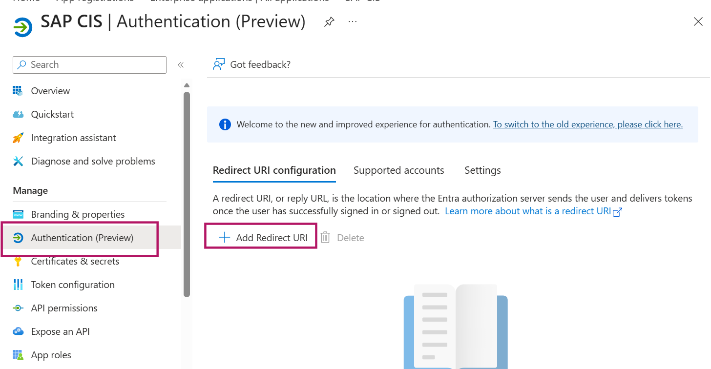

2. Choose **Web**, enter the first URI and click **Configure**:
   ```
   https://<cis_tenant>.accounts.ondemand.com/oauth2/callback
   ```

   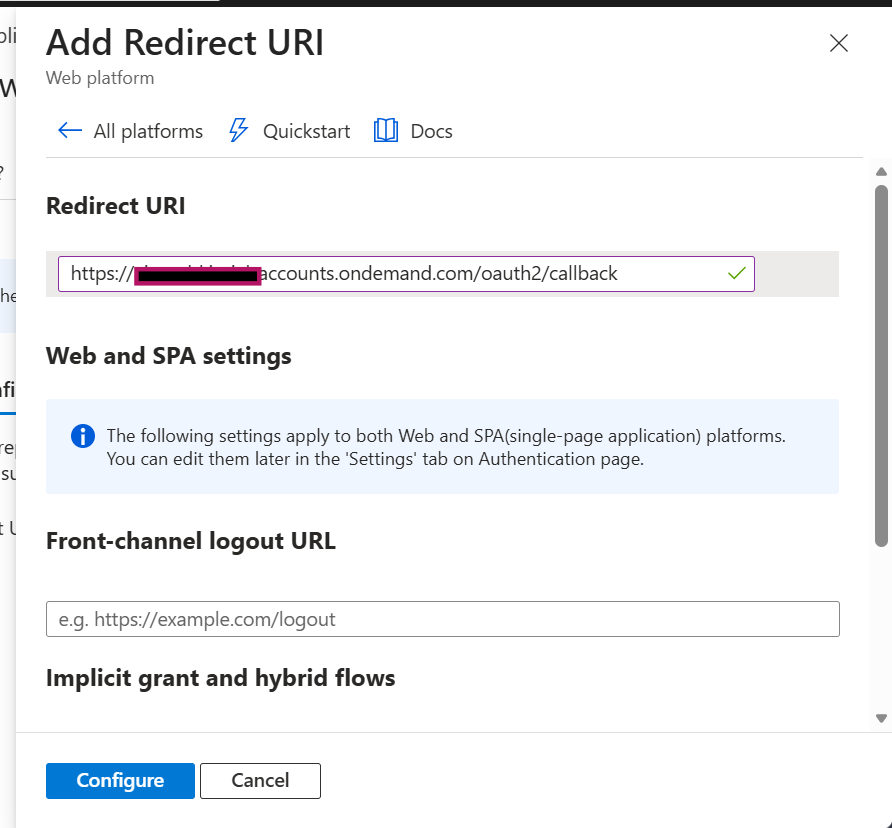

3. Repeat for the second domain:
   ```
   https://<cis_tenant>.accounts.cloud.sap/oauth2/callback
   ```

> [!NOTE]
> Trial IAS tenants use the `trial-accounts` domains (for example `https://<cis_tenant>.trial-accounts.ondemand.com/oauth2/callback`). Copy the hostname exactly as it appears in your IAS admin console URL.

### Step 1.5 — Add a federated identity credential for IAS

**What:** A federated credential that trusts JWTs issued and signed by your IAS tenant.
**Why:** When IAS exchanges the authorization code for tokens, it has to prove to Entra that it's the `SAP CIS` client. A client secret would work, but it's a shared secret that's sent on every request and expires (24 months at most), so it needs rotating. With a federated credential, IAS signs a short-lived JWT with its own private key. Entra checks the signature against the IAS public keys (JWKS) and compares the JWT's `iss`, `sub` and `aud` with the values configured here. There's no secret to leak or rotate.
**Role in the architecture:** This is step 9–10 of the [SSO sequence](#sso-authentication-sequence). It's the cryptographic half of the Entra ↔ IAS trust; the other half is the IAS configuration in Step 2.4.

1. Go to **Certificates & secrets → Federated credentials → Add credential**.

   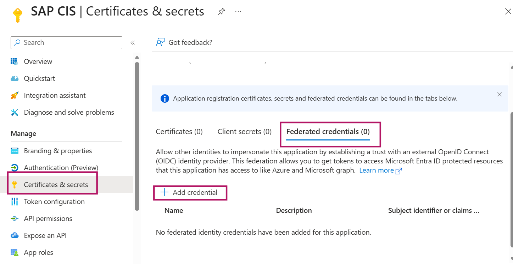

2. **Federated credential scenario:** *Other issuer*.
3. Enter:

   | Field | Value |
   |---|---|
   | **Issuer** | `https://<cis_tenant>.accounts.ondemand.com` |
   | **Type** | *Explicit subject identifier* |
   | **Value** | `<jwt_subject>`, e.g. `SAP-CIS-<cis_tenant>` |
   | **Name** | `SAP-CIS-Credential` |
   | **Audience** | `https://login.microsoftonline.com/<entra_tenant_id>/v2.0` |

4. Click **Add**.

> [!IMPORTANT]
> - The **Value** (subject) must match the **JWT Subject** you enter in IAS in Step 2.4 *character for character*.
> - The **Audience** field defaults to `api://AzureADTokenExchange`. Replace it: IAS sends the Entra v2.0 issuer URL as the audience, and a mismatch makes the token request fail.
> - The **Issuer** must be the IAS issuer exactly as it appears in the tenant's OIDC metadata (`https://<cis_host>/.well-known/openid-configuration`), with no trailing slash.

### Step 1.6 — Emit security groups in the token

**What:** A `groups` claim containing the object IDs of the user's security groups.
**Why:** Authorization in BTP is based on group membership. Entra doesn't include groups in tokens by default, so the claim has to be enabled per application.
**Role in the architecture:** This is the key link between Entra and BTP authorization. The GUIDs emitted here are what IAS forwards (Step 2.8) and what the BTP role collection is mapped to (Step 4.2).

1. Go to **Token configuration → Add groups claim**.
2. Select **Security groups** and click **Add**.

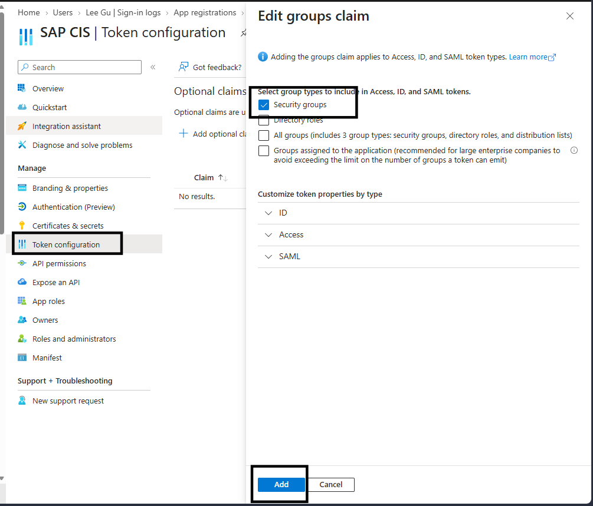

> [!WARNING]
> **Group overage:** if a user belongs to more than 200 groups, Entra leaves the `groups` claim out of the JWT and adds a link to Microsoft Graph instead. IAS doesn't follow that link, so the user gets no roles. In large tenants, pick **Groups assigned to the application** instead and assign the relevant groups to the enterprise application (Step 1.2).

### Step 1.7 — (Recommended) Add the email optional claim

**What:** The optional `email` claim on the **ID** and **Access** tokens.
**Why:** IAS uses the email claim as the subject name identifier (Step 2.6), and BTP uses it as the user name. Community feedback on the upstream blog is that IAS only passes on attributes that Entra actually *claims*, so adding the claim explicitly makes the user profile in BTP reliable.
**Role in the architecture:** It gives the shadow user in BTP a stable, readable identifier.

1. In **Token configuration**, click **Add optional claim**.
2. Token type **ID**, select `email` and click **Add**.
3. Repeat with token type **Access**.

*(No screenshot; this step isn't in the lab capture. Add `family_name` and `given_name` the same way if you want first and last names in BTP.)*

### Step 1.8 — Record the client ID and OIDC metadata URL

**What:** Two values IAS needs in order to find Entra and identify itself to it.
**Why:** The **OIDC metadata document** lets IAS discover Entra's authorize, token and JWKS endpoints automatically. The **Application (client) ID** is the `client_id` IAS presents.
**Role in the architecture:** These values finish the Entra-side configuration and are the inputs to Part 2.

1. On **Overview**, copy the **Application (client) ID** into `<client_id>`.
2. Click **Endpoints**, copy **OpenID Connect metadata document** into `<oidc_metadata_url>` and close the panel.

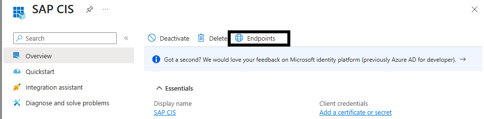

> [!IMPORTANT]
> Copy the **Application (client) ID**, *not* the Object ID. Both are shown on the overview page and look alike.

### Step 1.9 — Grant OpenID Connect API permissions

**What:** The delegated Microsoft Graph permissions `openid`, `profile`, `email` and `offline_access`, with admin consent.
**Why:** These scopes let IAS sign users in (`openid`), read basic profile and email claims (`profile`, `email`) and get a refresh token (`offline_access`). Granting admin consent up front means individual users don't see a consent prompt at their first sign-in.
**Role in the architecture:** They set what IAS is *allowed* to request. Step 2.5 sets what it *actually* requests.

1. Go to **API permissions → Add a permission**.

   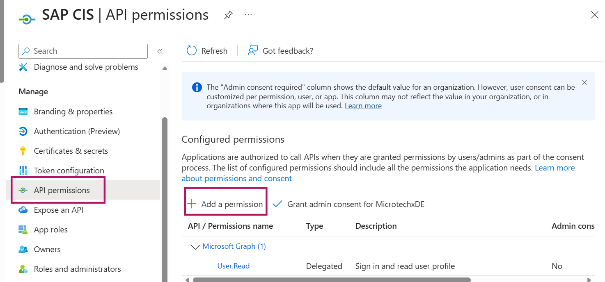

2. Select **Microsoft Graph → Delegated permissions**, expand **OpenId permissions**, tick all four, then click **Add permissions**.

   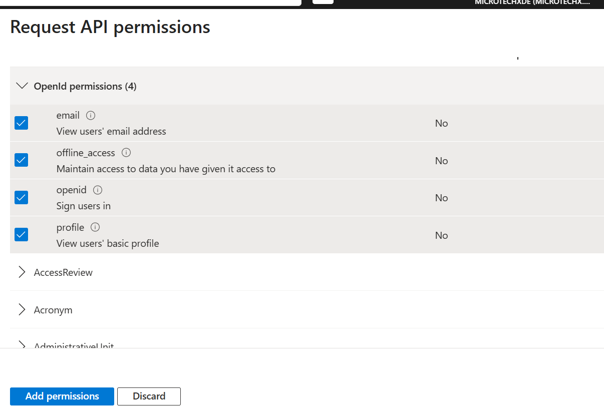

3. Click **Grant admin consent for \<tenant\>** and confirm.

   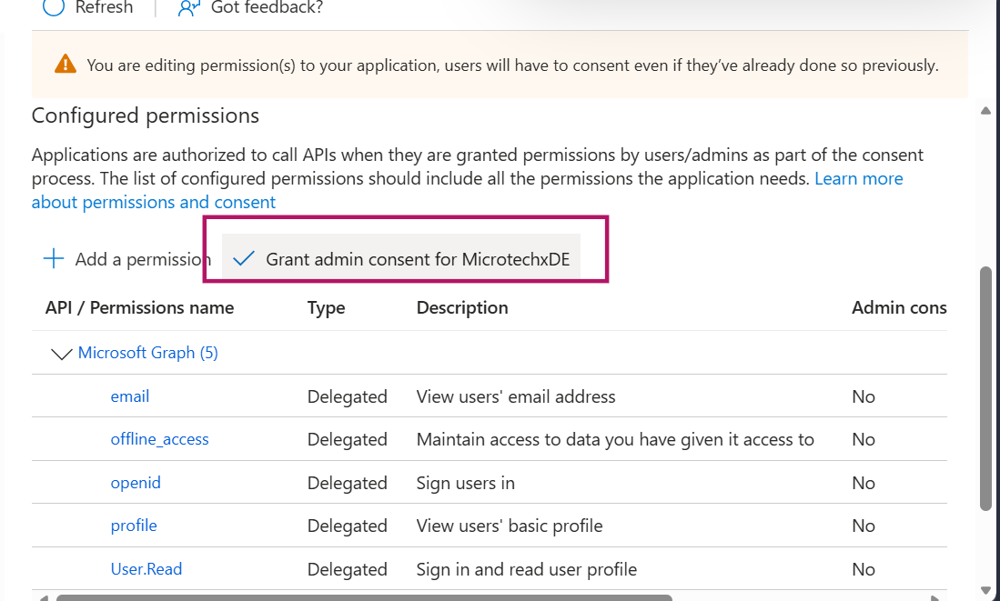

---

## Part 2 — SAP Cloud Identity Services: configure Entra as the corporate IdP

IAS now needs to trust Entra and forward authentication to it for the BTP subaccount.

### Step 2.1 — Open the IAS administration console

**What:** The IAS tenant admin console at `https://<cis_host>/admin`.
**Why:** All proxy settings are configured here.
**Role in the architecture:** IAS sits in the middle: BTP talks OIDC to IAS, and IAS talks OIDC to Entra.

1. Open `https://<cis_host>/admin` in a new tab. You can also open it from the BTP cockpit via the Cloud Identity Services subscription.
2. Go to **Identity Providers → Corporate Identity Providers**.

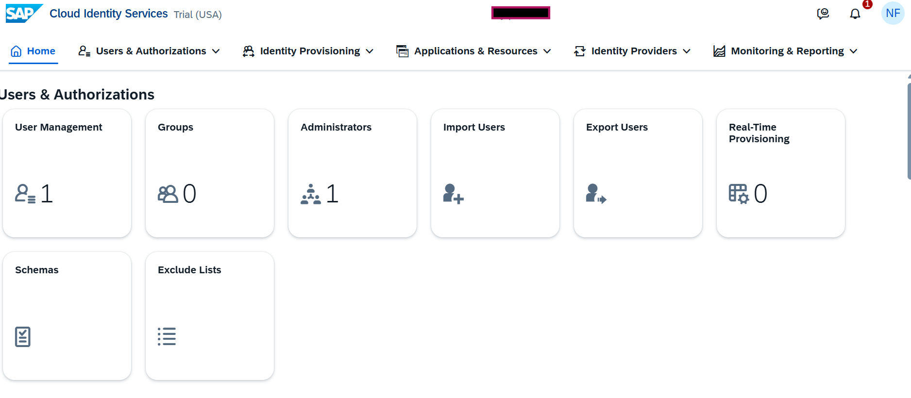

### Step 2.2 — Create the corporate identity provider

**What:** A corporate IdP of type *OpenID Connect Compliant*.
**Why:** A corporate IdP entry tells IAS to delegate authentication to an external IdP instead of checking passwords itself.
**Role in the architecture:** This is the IAS side of the Entra ↔ IAS trust, and the object applications point to in Step 2.7.

1. Click **Create**.
2. **Display Name:** e.g. `EntraID-tenant`.
3. **Identity Provider Type:** *OpenID Connect Compliant*.
4. Leave **Copy Settings** as *Don't copy (default)* and click **Create**.

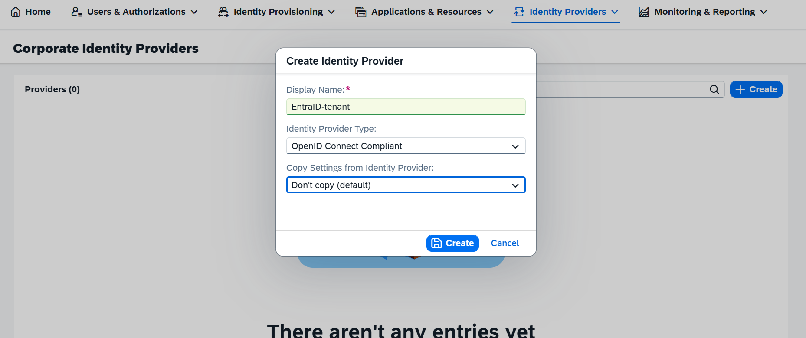

### Step 2.3 — Load Entra's OIDC metadata

**What:** The discovery URL for the Entra tenant.
**Why:** From one URL, IAS reads Entra's issuer, authorize, token and JWKS endpoints and refreshes them on a schedule, so there's nothing to maintain by hand if Microsoft rotates keys.
**Role in the architecture:** IAS needs this to redirect users to Entra and to validate the ID tokens Entra signs.

1. Open the new IdP and, on the **Trust** tab, select **OpenID Connect Configuration**.

   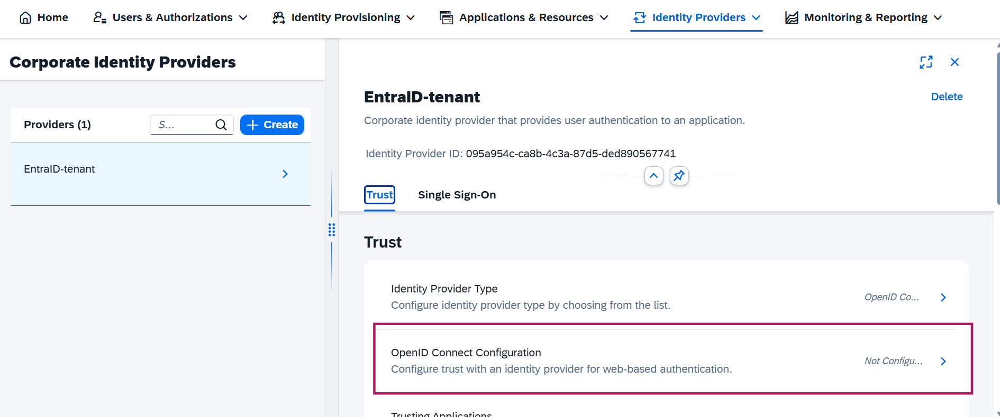

2. Paste `<oidc_metadata_url>` into **Discovery URL** and click **Load**.

   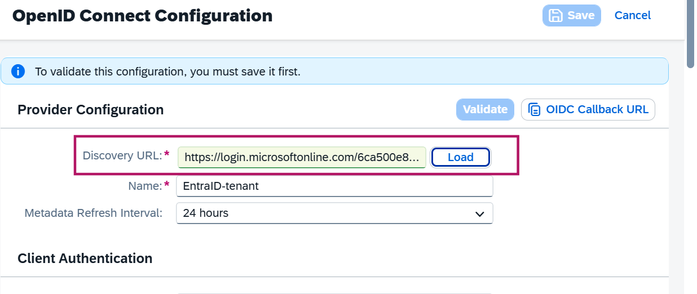

### Step 2.4 — Configure client authentication with a client assertion

**What:** Client authentication method *Client assertion in body*, the Entra client ID and the JWT subject.
**Why:** This is the IAS half of Step 1.5. IAS builds the signed JWT with `iss` set to its own issuer, `sub` set to the **JWT Subject** and `aud` set to the Entra issuer, then sends it with the token request instead of a secret.
**Role in the architecture:** It completes the secret-free client authentication in step 9 of the [SSO sequence](#sso-authentication-sequence).

1. Scroll to **Client Authentication**.
2. **Client Authentication Method:** *Client assertion in body*.
3. **Client ID:** `<client_id>` from Step 1.8.
4. **JWT Subject:** `<jwt_subject>`, exactly as entered for **Value** in Step 1.5.
5. Check that **JWT Issuer** (read-only) matches the **Issuer** in Step 1.5 and **JWT Audience** matches the **Audience**.

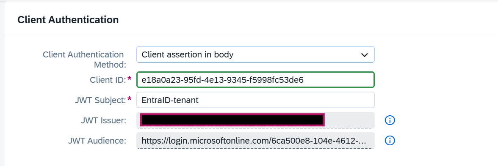

> [!IMPORTANT]
> In the screenshot, the **JWT Subject** field shows a value from the lab tenant. Don't copy it. Enter `<jwt_subject>` (`SAP-CIS-<cis_tenant>`). If this field and the federated credential's **Value** differ, Entra rejects the token request with *No matching federated identity record found*.

### Step 2.5 — Request the `offline_access` scope

**What:** Add `offline_access` next to the default `openid` scope.
**Why:** `offline_access` makes Entra return a refresh token, so IAS can renew the Entra session without sending the user through an interactive sign-in again.
**Role in the architecture:** It controls which of the permissions from Step 1.9 IAS actually uses.

1. Scroll to **Scopes**, click **Add** and enter `offline_access`.
2. Scroll up and **Save** the OpenID Connect configuration.

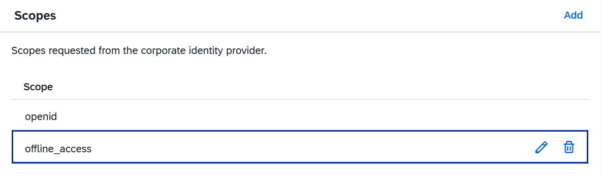

> [!TIP]
> SAP recommends also adding the standard `profile` and `email` scopes. That way BTP gets the usual user attributes (names, email) as standard claims.

### Step 2.6 — Use email as the subject name identifier

**What:** The corporate IdP's **Subject Name Identifier** is set to *Email*.
**Why:** By default IAS identifies the federated user by Entra's `sub` claim, which is an opaque value that differs for each application. Using email gives IAS, and BTP after it, an identifier people can read and that stays the same across applications.
**Role in the architecture:** It sets the identity key of the BTP shadow user created at first sign-in.

1. On the corporate IdP's **Trust** tab, select **Subject Name Identifier**.

   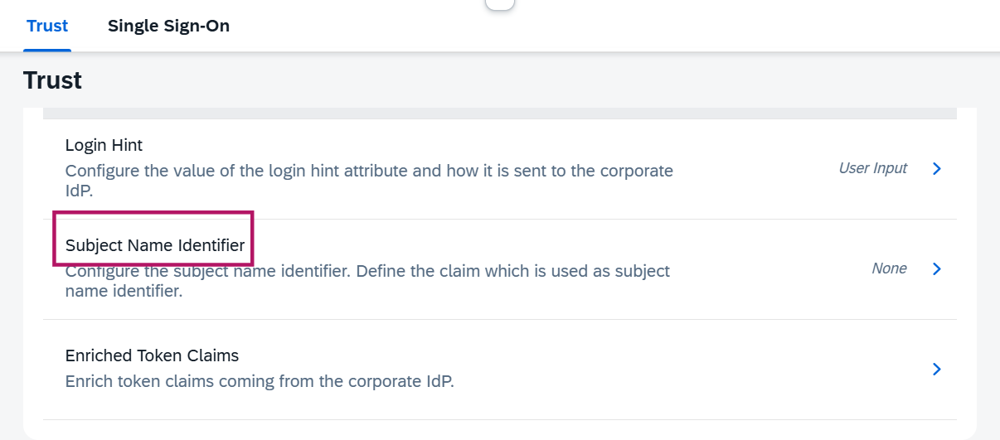

2. Select **Email** and click **Save**.

   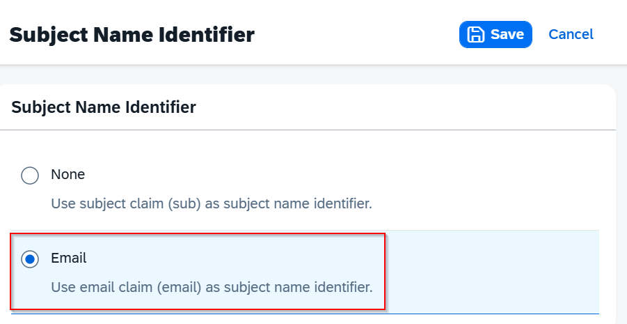

### Step 2.7 — Make Entra the default IdP for the BTP subaccount

**What:** The BTP subaccount application in IAS gets the Entra corporate IdP as its **Default Identity Provider**.
**Why:** Until this is set, IAS authenticates BTP users against its own user store. This setting is what makes IAS act as a proxy for this application.
**Role in the architecture:** This is step 4 of the [SSO sequence](#sso-authentication-sequence). It's applied per application, so other applications on the same IAS tenant aren't affected.

1. Go to **Applications & Resources → Applications**.
2. Under **Bundled Applications**, select your BTP subaccount (named `SAP BTP subaccount <name>`, with an `XSUAA_<guid>` identifier).
3. Open **Conditional Authentication**.

   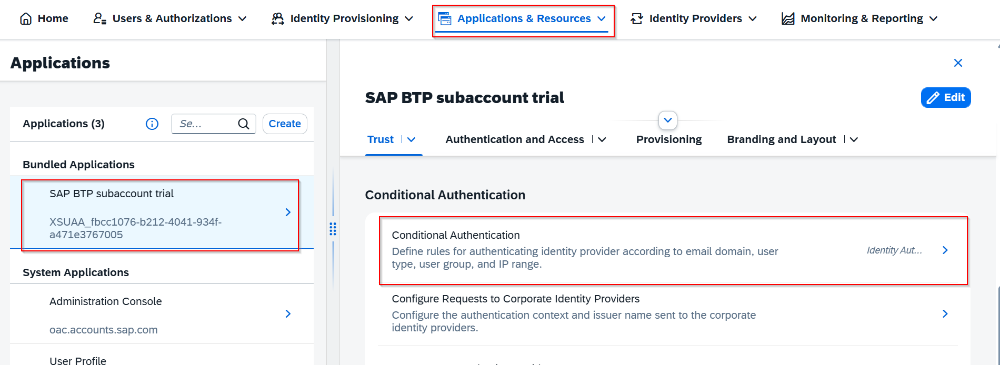

4. Under **Default Authenticating Identity Provider**, select your Entra IdP (e.g. `EntraID-tenant`) and click **Save**.

   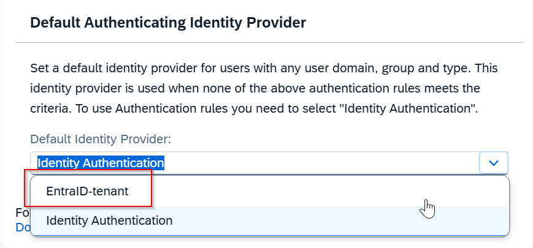

### Step 2.8 — Forward the `groups` claim to BTP

**What:** A self-defined application attribute `groups` with source *Corporate Identity Provider* and value `${corporateIdP.groups}`.
**Why:** IAS doesn't automatically pass every claim it receives from Entra on to the application. This mapping copies the Entra `groups` array into the token IAS issues to BTP.
**Role in the architecture:** It's the step before the authorization decision: without it, BTP never sees the group object IDs and every user ends up with *Access Denied*.

1. In the same BTP subaccount application, on the **Trust** tab, select **Attributes**.

   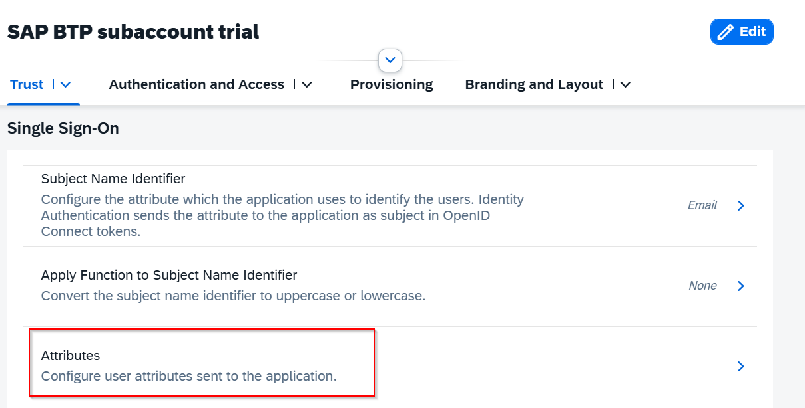

2. If `groups` exists, expand it; otherwise click **Add** and name it `groups`.
3. **Source:** *Corporate Identity Provider*. **Value:** `${corporateIdP.groups}`.
4. Click **Save**.

   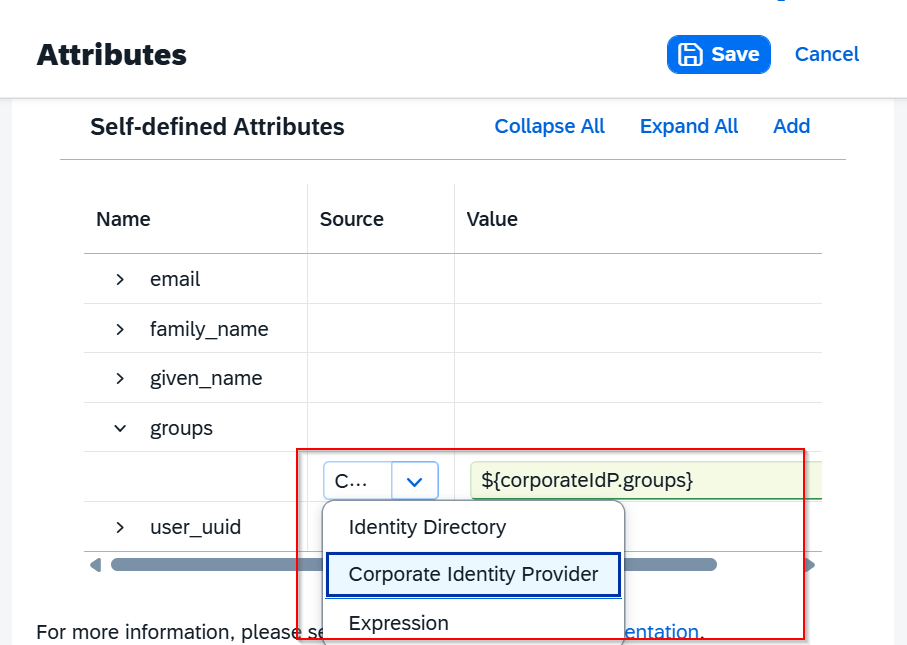

> [!NOTE]
> If `groups` already exists with an *Identity Directory* source (for example because IAS groups were created earlier), make sure the *Corporate Identity Provider* entry is also there. If it isn't, delete the attribute and add it again with the correct source.

---

## Part 3 — Validate the OIDC proxy

**What:** The built-in **Validate** function of the corporate IdP.
**Why:** It runs a real authorization code flow against Entra and shows the resulting token *before* any BTP user depends on it. This isolates Entra ↔ IAS problems (redirect URI, federated credential, scopes) from BTP problems.
**Role in the architecture:** It tests steps 5–11 of the [SSO sequence](#sso-authentication-sequence) on their own.

1. Go to **Identity Providers → Corporate Identity Providers**, select the Entra IdP and open **OpenID Connect Configuration**.

   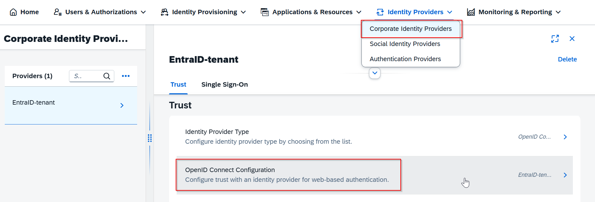

2. Click **Validate**. The configuration must be saved first. A new tab opens on the Microsoft sign-in page.
3. Sign in with an Entra user. If prompted, accept the requested permissions.

   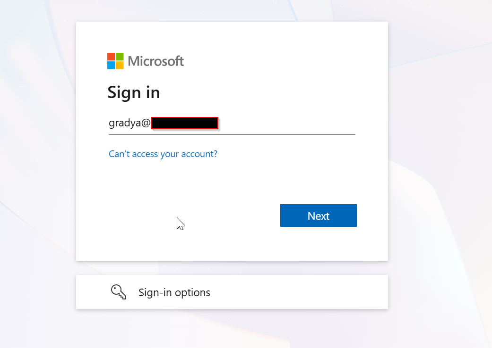

4. Check that **Step 1 – Authorization Code** and **Step 2 – Token** both show **Success**, and that the `groups` claim lists GUIDs.

   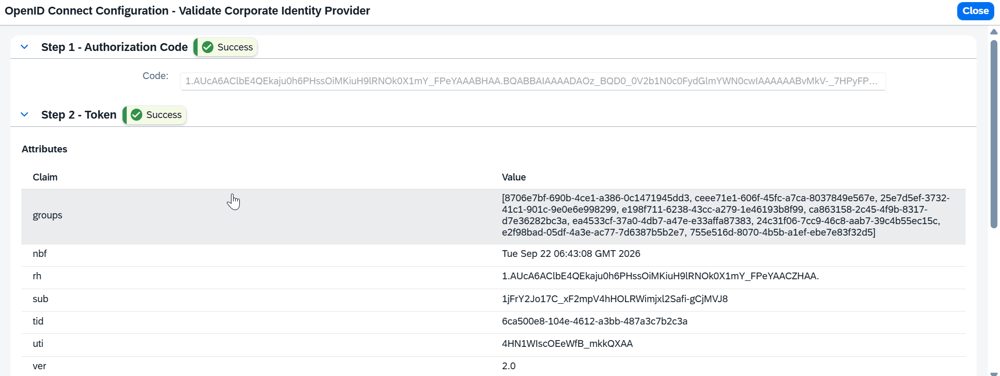

If Step 1 fails, check the redirect URIs (Step 1.4). If Step 2 fails, check the federated credential and the client assertion settings (Steps 1.5 and 2.4). If there's no `groups` claim, check Step 1.6.

---

## Part 4 — Map an Entra group to a BTP role collection

### Step 4.1 — Create the Entra security group

**What:** A security group `BTP-Developers` with *Assigned* membership.
**Why:** The group is the unit of authorization: membership means "is a BAS developer". *Assigned* membership lets the access package (Part 5) add and remove members. Dynamic groups can't be managed by access packages.
**Role in the architecture:** Its **object ID** is the value that appears in the `groups` claim and gets mapped in BTP.

1. Go to **Entra ID → Groups → New group**.
2. **Group type:** *Security*. **Group name:** `BTP-Developers`. **Description:** e.g. *Group for developers working on SAP BAS*. **Membership type:** *Assigned*.
3. Click **Create**.

   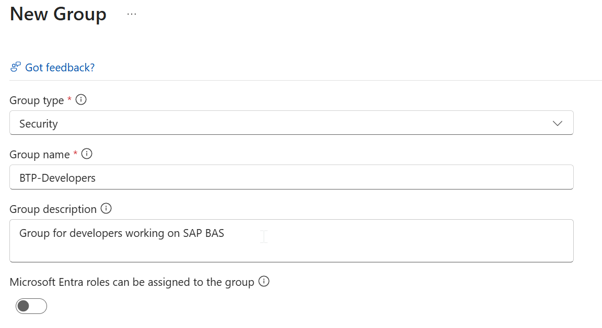

4. Open the group and copy its **Object ID** into `<group_object_id>`.

   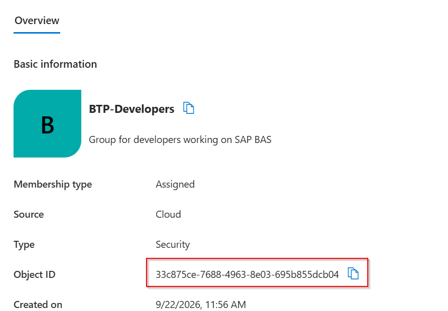

> [!NOTE]
> Don't add members by hand. Membership should come only from the access package, so there's an approval record for every grant.

### Step 4.2 — Assign the group to the role collection

**What:** A user group mapping on `Business_Application_Studio_Developer`: identity provider = the IAS tenant, name = `<group_object_id>`.
**Why:** BTP role collections can be assigned to individual users *or* to IdP group values. A group mapping means BTP never has to be touched when people join or leave; membership in Entra is enough.
**Role in the architecture:** This is the authorization decision in step 13 of the [SSO sequence](#sso-authentication-sequence). XSUAA compares each value in the incoming `groups` claim with the user groups on each role collection.

1. In the BTP cockpit, open the subaccount that trusts IAS and go to **Security → Role Collections**.
2. Select **Business_Application_Studio_Developer**.

   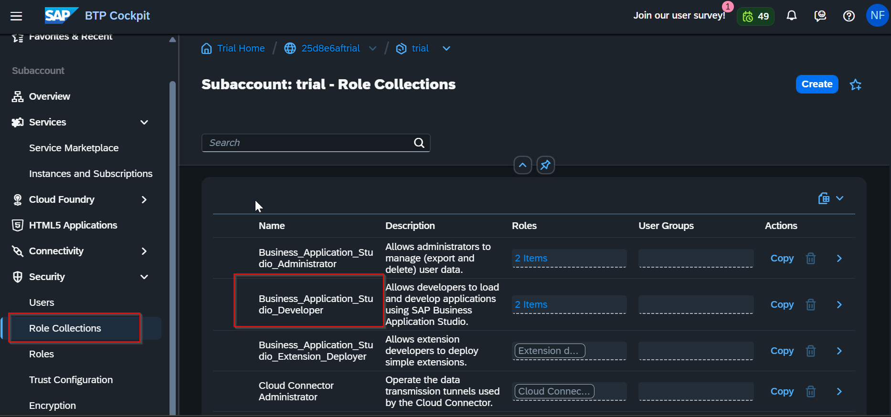

3. Click **Edit**. Under **User Groups**, select the IAS tenant (`<cis_host> (business users)`) as the **Identity Provider** and paste `<group_object_id>` into **Name**.
4. Click **Save**.

   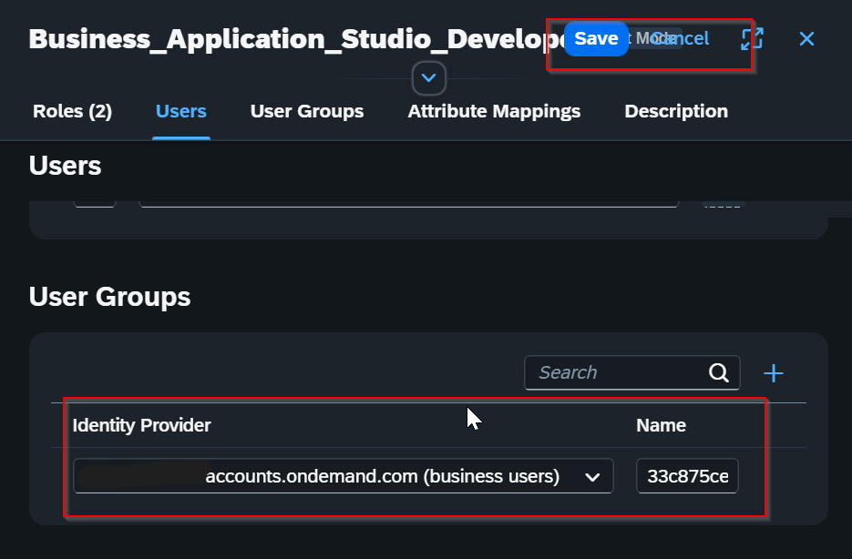

> [!IMPORTANT]
> The **Name** is the group's **object ID** (GUID), not its display name. The `groups` claim contains only GUIDs.

---

## Part 5 — Govern group membership with an access package

**What:** An Entra ID Governance access package `BTP Developers` that grants membership of `BTP-Developers` after approval.
**Why:** Without it, someone has to add users to the group by hand, with no request trail, approval or expiry. The access package turns "give me BAS access" into a self-service workflow with an approver, a justification and a lifecycle policy, all audited in Entra.
**Role in the architecture:** It governs the *input* to the authorization chain. Approving a request adds the user to the group, and the next sign-in carries the new group ID to BTP. Nothing changes in IAS or BTP.

### Step 5.1 — Create the access package

1. Go to **ID Governance → Entitlement management → Access packages → New access package**.

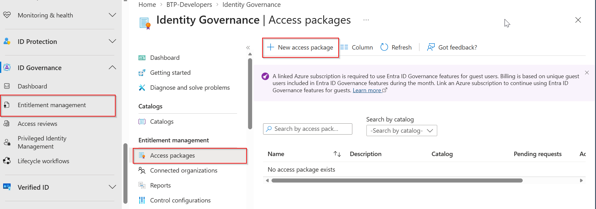

### Step 5.2 — Basics

1. **Name:** `BTP Developers`. **Description:** e.g. *Access package for granting developers access to SAP BAS*.
2. **Catalog:** *General* (or a dedicated SAP catalog if your organization uses one).

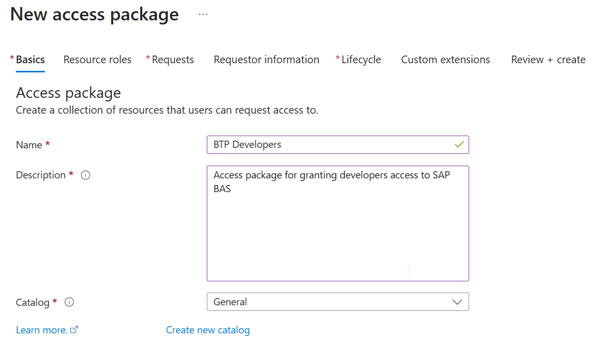

### Step 5.3 — Resource roles

**Why:** This is where the package is bound to the group that BTP maps.

1. Click **Groups and Teams**. Tick the option to show groups not in the catalog, search for `BTP-Developers` and select it.
2. Set **Role** to **Member**.

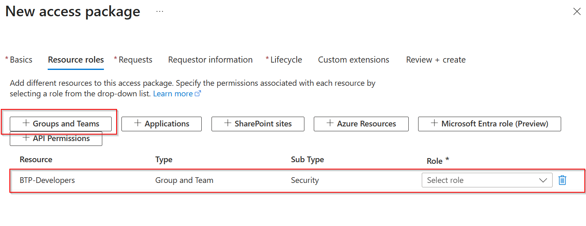

> [!IMPORTANT]
> The screenshot shows **Role** still as *Select role*. Choose **Member**, or approved users won't be added to the group.

### Step 5.4 — Requests and approval policy

**Why:** The policy decides who may ask for access and who has to approve it.

1. **Who can get access:** *For users, service principals, and agent identities in your directory* (older portal versions: *For users in your directory*). **Scope:** *All members (excluding guests)*.

   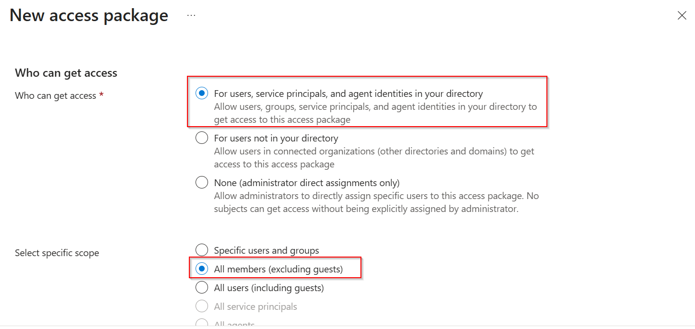

2. **Who can request access:** tick **Self** so users can request for themselves. *Admin* is always on.

   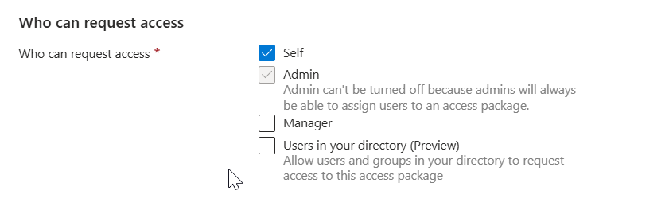

3. **Approval:** **Require approval** *Yes*, one stage. For **First Approver**, choose *Choose specific approvers* and add your approver user. Keep **Require approver justification** on.

   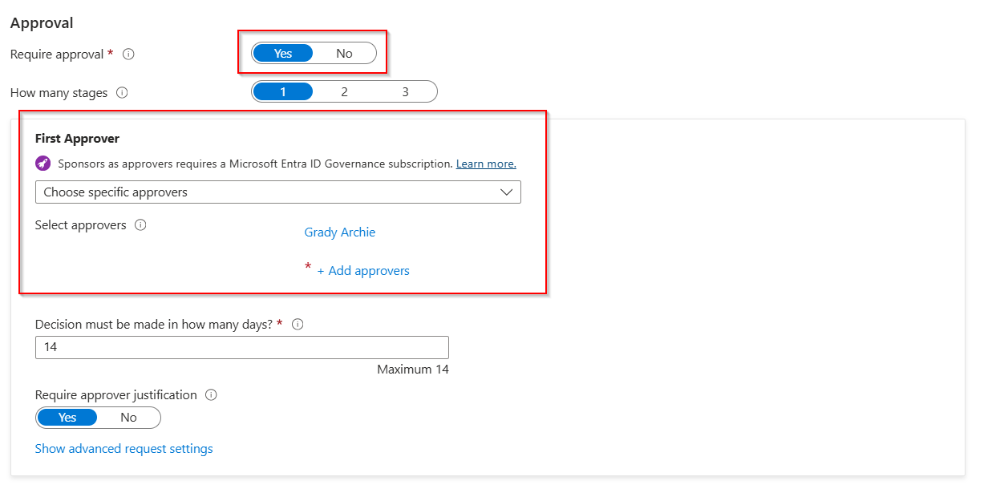

4. Make sure **Enable new requests** is *Yes*.

### Step 5.5 — Review and create

1. Keep the defaults on **Requestor information**, **Lifecycle** and **Custom extensions**, then go to **Review + create** and click **Create**.

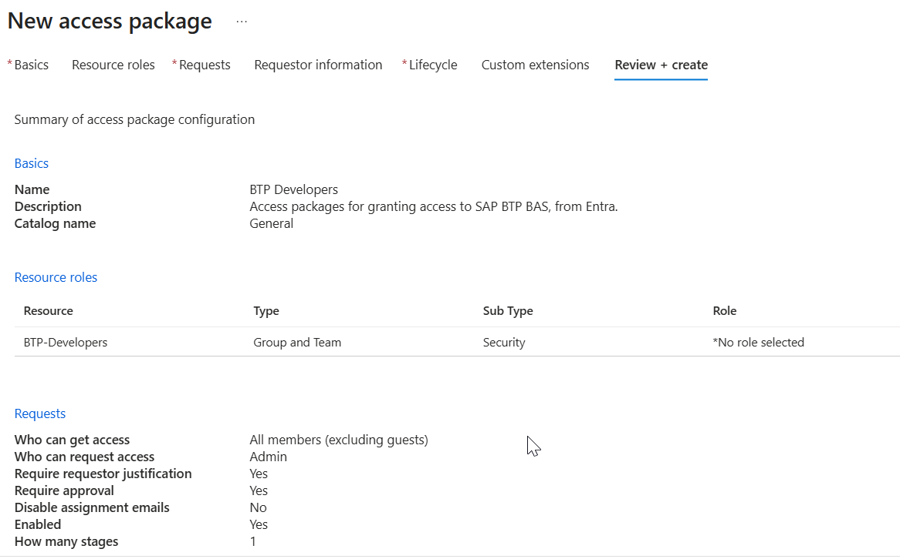

> [!NOTE]
> This summary was captured before two corrections. Your summary should show **Who can request access: Self** (not *Admin*) and **Role: Member** for `BTP-Developers` (not *No role selected*).

2. After creation, open the package and copy the **My Access portal link** into `<myaccess_link>`.

> [!TIP]
> For production, set an expiry on the **Lifecycle** tab (e.g. 180 days) and consider access reviews, so BTP access is recertified instead of lasting forever.

---

## Part 6 — End-to-end test

Use a **private browser window** for each role so that Entra, IAS and BTP sessions don't mix.

### Step 6.1 — Confirm access is denied without group membership

**Why:** It proves that authentication works while authorization is correctly withheld. The user gets in, but has no role.

1. In the BTP cockpit, go to **Services → Instances and Subscriptions** and copy the **SAP Business Application Studio** URL into `<bas_url>`.
2. Open `<bas_url>` in a private window. If the subaccount still has the SAP ID service trust, you'll see a choice of IdPs. Pick the IAS tenant, not *Default Identity Provider*.

   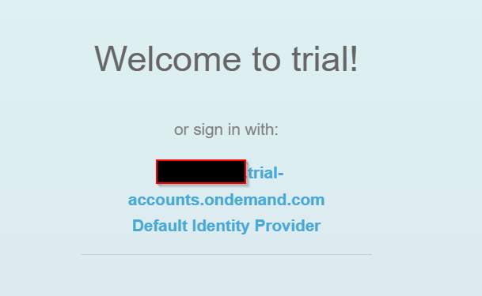

3. You're redirected to Entra. Sign in as the **requester**.
4. BAS shows **Access Denied**, because the token has no `BTP-Developers` object ID, so no role collection matches.

   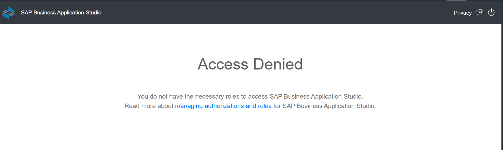

### Step 6.2 — Request the access package (requester)

1. In a private window, open `<myaccess_link>` and sign in as the **requester**.
2. On **BTP Developers**, keep **Requesting for: Yourself** and click **Continue**.

   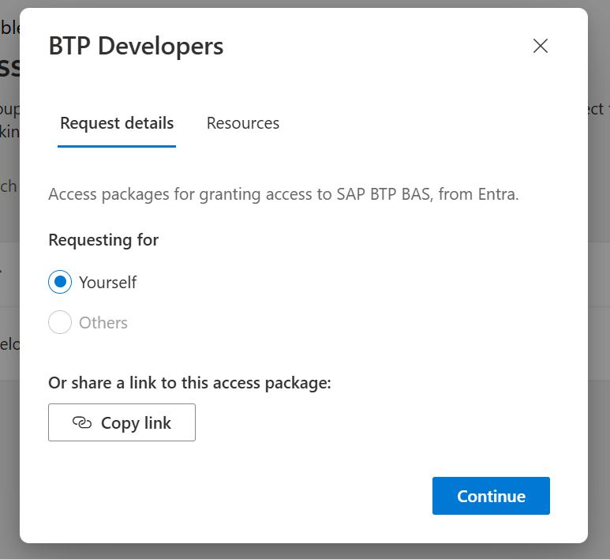

3. Enter a **Business justification** and click **Submit request**.

   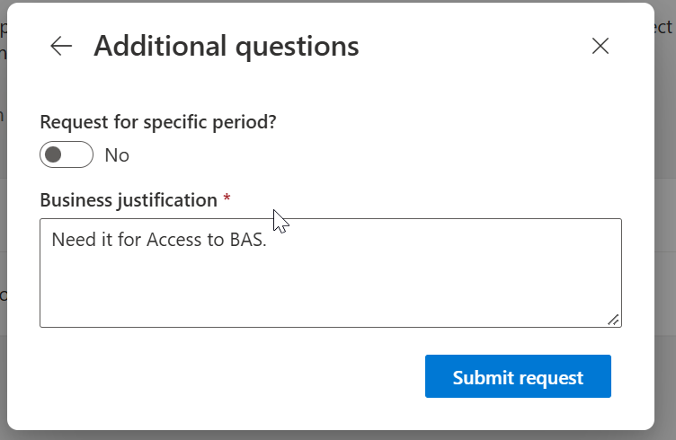

### Step 6.3 — Approve the request (approver)

1. In a new private window, open `https://myaccess.microsoft.com` and sign in as the **approver**. The pending request appears under **Your pending actions**.

   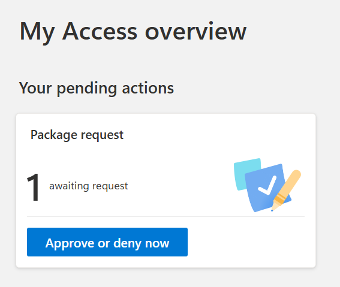

2. Go to **Approvals**, select the request, click **Approve**, add a justification and **Submit**.

   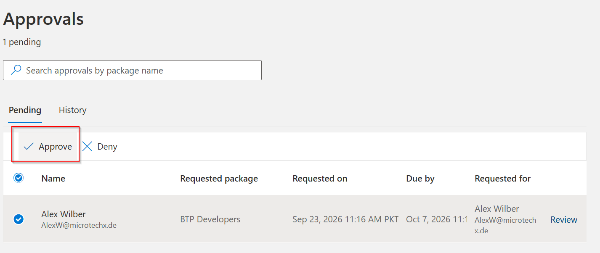

Entra now adds the requester to `BTP-Developers`. It can take a few minutes for the membership to show up in tokens.

### Step 6.4 — Confirm access is granted

**Why:** It proves the whole chain: the approval led to group membership, which put the object ID in the `groups` claim, which IAS forwarded, which matched the role collection and let BAS open.

1. Open `<bas_url>` in a **new** private window and sign in as the **requester**.
2. BAS opens.

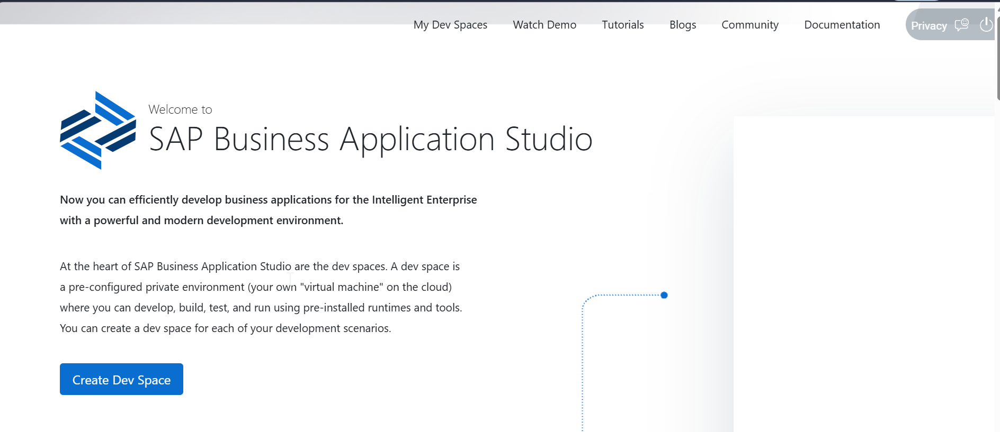

---

## Validation

| # | Check | Expected result |
|---|---|---|
| V1 | IAS → corporate IdP → **Validate** (Part 3) | Authorization code and token steps both succeed; `groups` claim present |
| V2 | Requester opens BAS **before** approval (Step 6.1) | Entra sign-in, then *Access Denied* |
| V3 | Requester opens BAS **after** approval (Step 6.4) | BAS welcome page |
| V4 | BTP cockpit → **Security → Users**, find the requester | Shadow user with the IAS tenant as origin; `Business_Application_Studio_Developer` listed as assigned through a group |
| V5 | Entra → access package → **Assignments** | Requester listed as *Delivered* |

## Troubleshooting

| Symptom | Likely cause | Fix |
|---|---|---|
| Entra error `AADSTS50011` (redirect URI mismatch) | Callback URL missing or wrong domain (for example a trial tenant without `trial-accounts`) | Step 1.4 |
| Validate step 2 fails with `invalid_client` / *No matching federated identity record found* | Issuer, subject or audience differ between the federated credential and IAS | Compare Step 1.5 with the read-only JWT fields in Step 2.4 |
| Validate works but there's no `groups` claim | Groups claim not configured, or group overage (more than 200 groups) | Step 1.6 |
| Sign-in to BAS works, *Access Denied* even after approval | Old session or token still cached | Sign out, close all windows and retry in a new private window |
| | Group display name used instead of object ID | Step 4.2 |
| | `groups` attribute not mapped from the corporate IdP | Step 2.8 |
| | Access package resource role not set to **Member** | Step 5.3 |
| | Role collection user group bound to the wrong IdP (e.g. SAP ID service) | Step 4.2 |
| BTP login goes to the SAP ID service instead of Entra | Default IdP not set on the BTP application in IAS, or the wrong IdP chosen on the BTP login page | Step 2.7; choose the IAS tenant on the login page |
| BTP user has no first or last name, or the user name is odd | Claims not emitted by Entra or scopes not requested | Steps 1.7 and 2.5 (add `profile` and `email`) |
| Requester can't see the package in My Access | *Self* not allowed, new requests disabled, or requester outside the policy scope | Step 5.4 |

