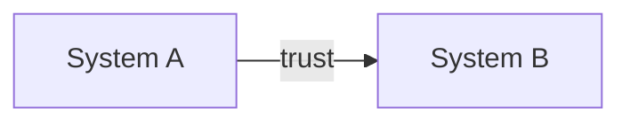

<!--
  HOW TO USE THIS TEMPLATE
  1. Copy the folder layout:
       implementation/NN-short-slug/
         README.md        ← this file, filled in
         assets/          ← screenshots, zero-padded: 01.png, 02.png, …
  2. Delete any section that doesn't apply rather than leaving it empty.
  3. Remove this comment block.

  CONVENTIONS
  - Steps are numbered <Part>.<Step> (e.g. 2.3) so they can be referenced from
    Troubleshooting and from other guides.
  - Each step has three short parts: **What**, **Why**, **Role in the architecture**,
    followed by the numbered click-path.
  - Screenshots: relative path, alt text describing what the image shows, placed
    directly after the instruction it illustrates:
        
    Screenshot numbers do not need to match step numbers.
  - Placeholders use <angle_brackets>; define every placeholder in "Values to collect".
  - Callouts use GitHub alert syntax: > [!IMPORTANT], > [!NOTE], > [!WARNING].
  - Diagrams are Mermaid, used only for flows and relationships, not decoration.
    Keep node labels short; put the explanation in the prose below the diagram.
  - UI labels are **bold**; navigation paths use →, e.g. **Security → Role Collections**.
  - Literal values the reader types or copies go in `code`.
-->

# <Guide title>

> <One-paragraph summary: what this guide sets up, and what the end user gets once it's done.>

## At a glance

| | |
|---|---|
| **Goal** | <one sentence> |
| **Systems** | <System A>, <System B> |
| **Estimated time** | <e.g. 60–90 min> |
| **Roles required** | <admin roles needed in each system> |
| **Out of scope** | <what this guide deliberately does not cover> |

## Architecture

<One paragraph per component: what it is and what it's responsible for in this setup.>

## Prerequisites

- [ ] <Tenant / subscription / entitlement>
- [ ] <Admin role>
- [ ] <Test user(s)>

## Values to collect

Values you copy in one step and paste in a later one. Keep this table next to you while you work.

| Placeholder | Where you get it | Where you use it |
|---|---|---|
| `<value_name>` | Step 1.2 | Step 2.4 |

---

## Part 1 — <System>: <outcome of this part>

### Step 1.1 — <Imperative action>

**What:** <What is being configured.>
**Why:** <What breaks or is missing without it.>
**Role in the architecture:** <How it connects to the other parts: trust, claims, authorization, governance.>

1. Go to **<Menu → Submenu>**.
2. Set **<Field>** to `<value>`.

> [!IMPORTANT]
> <Anything that fails silently if it's wrong.>

---

## Validation

| # | Check | Expected result |
|---|---|---|
| V1 | <action> | <observable outcome> |

## Troubleshooting

| Symptom | Likely cause | Fix |
|---|---|---|
| <error text / behaviour> | <cause> | <see Step N.M> |

## References

- <Upstream source>
- <Vendor documentation>
